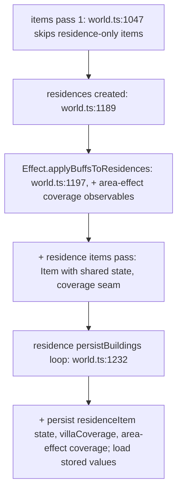
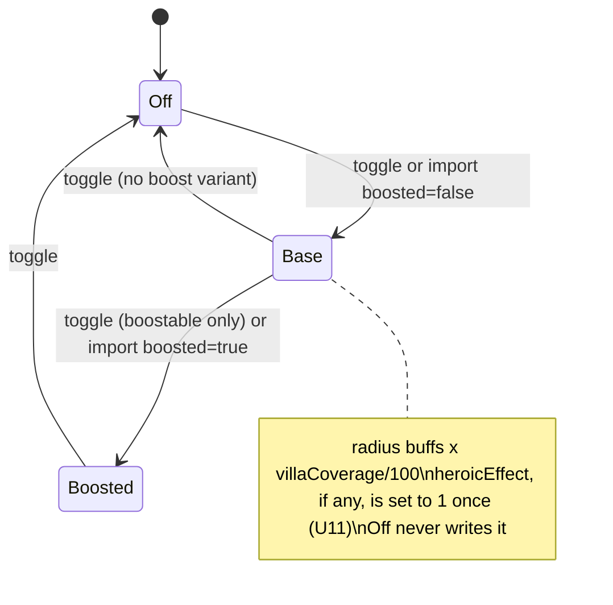

# Residence Items - Plan

## Goal Capsule

- **Objective:** Specify how the exchange fields `residenceItems`, `villaCoverage`, `residenceEffects` and `publicCoverages` (items socketed in villas and officia whose radius effect reaches residences, and the coverage of area effects and public buildings over residences) are imported, exported and applied in the calculator, in answer to Taludas' question of 2026-11-12 ("Would you apply governor suppliers and residenceItems in the calculator? They cover most of the remaining demand differences in the test plan.", anno-117-savegame-exchange-format issue 1, comment 6825300752).
- **Product authority:** The maintainer owns what the calculator models. The exchange spec owns the field shape (`spec/format.md:88-89`, `schema/anno117-exchange.schema.json:294-304` in the spec repo). The planner is the reference for the intended effect (see Evidence).
- **Modelling rule:** The calculator shows and applies only what it has data for. Entries without data are preserved in the export and named in `ImportPlan.report`; they produce no row, no marker and no on-screen report.
- **Open blockers:** Units U3 to U6 need `allocation` on residence items in `js/params.js`; unit U11 needs `heroicEffect` (the effect GUID) on items and the referenced `Specialist Mythic NN Islandwide` effects in `params.effects` (extractor hand-off A, `C:\dev\asset-extractor\docs\handoff-residence-items.md`). Unit U10 needs the public-building records of hand-off B. Units U1, U2, U8 and U9 do not depend on the extractor. Unit U7 (needs table) needs no extractor data for its attribute columns (`params.needs` carries all eight attributes, `supplyWeight` and `dlcUnlocks`); only its supply-building and coverage columns wait for hand-off B and appear when that data exists. `js/params.js` holds only the qualifying residence items (consumption or residents effect), as the hand-off states.
- **Villa scope:** The villa dialog lists residence items, that is items whose radius effect reaches residences, and applies that radius effect to residences. An item that has an island-wide (heroic) effect switches that effect on when it is activated, in the villa dialog, in the factory dialog or by import, and never switches it off (R4). The dialog shows the state of that effect as a hint icon on the item and holds no column for the effect's values (R11, R13).

## Product Contract

### Evidence

Calculator:
- `residenceItems` is read and kept without effect: `src/exchange/reader.ts:77` (listed as `KEPT`), typed at `src/exchange/types.ts:248`. No import code consumes it and the exporter never writes it.
- Items of the island-wide kind take effect through a different route. Mythical-item effects (19 effects with `source: "mythical-item"` in `js/params.js`; 6 of them target residences) are island effects with a 0/1 `scaling`, persisted as `island.effect.<guid>.scaling`. The import turns an item holder's item (`mythicEffect`, `boostConditionMet`) into that value: `src/exchange/import-islands.ts:385-412`. Design: `docs/superpowers/specs/2026-07-06-mythical-items-design.md`; display of residence targets: `src/production.ts:1020-1056` (`applyBuffsToResidences`).
- 14 entries of `params.items` list residence buildings among their targets (counted from `js/params.js`; guids 156712, 41350 to 41355, 41360, 42048, 42053, 51288, 160084, 149292, 155327). `Item` builds its factory list from targets that pass `isConstructible` (`src/production.ts:1087`), and residences are created after the first item pass (`src/world.ts:1190-1200`), so these 14 items never bind to a residence (U1 turns this reading into a test). `js/params.js` carries no `allocation` and no `heroicEffect` on any item, the two facts the planner uses to select residence items and to split radius from island-wide effect (`paxplanner/savegame/convert.py:1195-1206`, `paxplanner/model/engine.py:277-279`).
- The buffs of those items differ in kind: item 160084 carries `goodConsumptionUpgrade` -20 (base buff 160085) and -30 (boost buff 160086) for product 2137 (Bread); items 41352 and 42053 carry `additionalWorkforces` and `workforceModifierInPercent` 10 only.
- Items acting on residences were declared out of scope for the equip toggle because their in-game residence effects were judged too small to model: `docs/task_tristate_boost_toggle.md:25`.
- Per-residence effect coverage (`ResidenceEffectCoverage`, `src/consumption.ts:493`; `effectCoverage` in `src/population.ts:35`; persisted per residence at `src/world.ts:1234-1239`) is dead code. `ResidenceEffect` is never constructed (the loader of `params.residenceEffects` is commented out at `src/world.ts:1225-1230`; `js/params.js` has no such key), `ResidenceBuilding.allEffects` stays empty, and `applyEffects` (`src/population.ts:227-240`) drops every stored key. The class models a different design: a `ResidenceEffect` holds per-product consumption entries and a list of residences (`src/consumption.ts:409-457`), a different model from the buff-based area effects of Anno 117. Its stored `<residence>.effectCoverage` keys are exported raw under `ext.calculator.store`.
- Area effects on residences are already modelled as `Effect` objects of `source: "building"` whose `AppliedBuff` entries sit on each target residence. Of the 70 such effects in `js/params.js` with residence targets, 27 carry a `population` buff and 43 carry `providedNeedUpgrade`, a field that is read into `Buff.providedNeedUpgrade` (`src/production.ts:588`) and consumed nowhere. The effect is switched on island-wide with a 0/1 `scaling` (`RangeEffect.checked`, `src/views.ts:748-751`), with no per-tier share.
- Public services are modelled as needs, not as buildings: 40 of 151 entries of `params.needs` have `isBuilding: true`, category `Public`, no consumption rate (`needConsumptionRate: null` on the residence) and a `Population` attribute (need 2750 "Roman Public Market", product 2671 "Service Roman Market", `Population` 1). `ResidenceNeed.residents` is `constructed * need.residents` while the need is checked (`src/consumption.ts:261-266`). `js/params.js` has no public-building records: the `publicServices` pipeline is commented out (`src/world.ts:841-853`) and no key links a public-building GUID to the needs it provides.

Planner (read-only, `C:\Dev\Anno-117-Planner`):
- `residence_items` holds villa and officium items whose effect targets residences; the savegame import keeps only items with `allocation == "Villa"` and a residence target (`paxplanner/savegame/convert.py:1195-1206`).
- Their effect sources are scaled by `villa_coverage` (percent of residences inside the radius, default 100), except `heroic` (island-wide) effects, which keep full scale: `paxplanner/model/engine.py:494-502`, `villa_share` at `:1248`.
- An area effect on residences is scaled by `percent / 100` of the tier it is entered for (`engine.py:697-712`, `residence_area_sources`). A public building's share is the percent of a tier's residences in range; an unlisted building uses the island's `publicCoverage` (default 100) when a tier needs the building, otherwise 0 (`engine.py:1199-1227`).
- Export writes `residenceItems`, `villaCoverage`, `residenceEffects`, `publicCoverages` and `publicCoverage` (`paxplanner/model/exchange_export.py:197-201`).

Grounding file (planner export `Marcia 69.new.planner.exchange.json`, 22 islands):
- `villaCoverage` is the object `{"default": n}` on all 22 islands (values 2.6, 20.9, 42.1, 82, 100).
- 9 islands carry `residenceItems`, 35 entries over 27 distinct items; one island lists item 51833 twice. Only items 41352 and 42053 exist in `params.items` (both with workforce buffs only). Example (island Cinis): `[{"item":140388,"boosted":false}, ..., {"item":41352,"boosted":true}, ...]`.
- 16 islands carry `residenceEffects` as `{level GUID: {effect GUID: percent}}` and `publicCoverages` as `{level GUID: {building GUID: percent}}`. Example (island Nusquam, effect 99014 "Oysters with Caviar Building", `population` 1 per residence): `{"1496": {"99014": 62.5, ...}, "1497": {"99014": 5.0, ...}, "1498": {"99014": 63.8, ...}, "1499": {"99014": 90.6, ...}}`; the island has 64, 40, 756 and 32 residences of those levels. Percent values go down to 0.1 and up to 100.
- The 16 islands name 102 distinct effect GUIDs; 9 exist in `params.effects` (151414, 99058, 99014, 99062, 159732, 184287, 154296, 183335, 184285; all `source: "building"`, scope `Radius` or `StreetDistance`, buffs `population` 1 or 3). The other 93 (for example 140536, 99077, 82057, 137878, 98994) exist in no array of `params.js`.
- The 39 building GUIDs of `publicCoverages` (3527, 3528, 3615 to 3621, 19753, 31367, 31368, 152714 and others) exist in no array of `params.js`. The scalar `publicCoverage` is 100 on all islands.
- No island lists an area effect in `effects`; the file states area effects through `residenceEffects` alone. `effects` holds mythical-item effects (island Juliana: `{"166481": 1}`).
- `appliedEffects` (471 entries, sources `item`, `area`, `building`) states the share of range effects per production building type, for example `{type: 3174, effect: 51635, source: "item", share: 1.0, applied: true, method: "circle"}`; the calculator keeps it unapplied (Scope Boundaries).

Spec: the field row (`spec/format.md:89`) names `{default?, byLevel?, byResidence?}` with lookup order `byResidence`, `byLevel`, `default` for all three of `villaCoverage`, `residenceEffects` and `publicCoverages`. Only `villaCoverage` is typed as a `coverage` object in the vendored schema (`vendor/anno117-exchange/schema/anno117-exchange.schema.json:302`, `$defs.coverage` at `:336-343`); the other two are plain `object`. The planner writes the level-and-GUID shape for them.

### Problem

A savegame or planner file that lists residence items and coverage values states demand-affecting effects (consumption reductions, population bonus) that the calculator drops on import. Taludas reports that these items, together with governor suppliers, explain most of the remaining demand differences between the calculator and the planner. The calculator has a mechanism for island-wide item effects but no route from `residenceItems` to it, and no notion of a share of residences in range.

### Actors

- Player importing a planner or savegame-derived file and comparing demand with the planner.
- Taludas and NiHoel, maintaining the planner and the cross-tool test plan.
- Maintainer deciding the modelling scope.

### Requirements

**Import of residence items**
- R1. Each `residenceItems` entry whose item is a villa item (`isVillaItem` over the extractor fields of hand-off A, KTD2) stores the item's state for the imported island; the item's radius buffs then apply to the island's residences (R6). The data covers every residence item whose effect changes consumption or residents.
- R2. An entry whose item has no calculator data (absent from `params.items`, or present and not a villa item per KTD2) is not applied and not shown on screen. It stays in the preserved data and returns on export unchanged. `ImportPlan.report` names it (R10).
- R3. `boosted: true` selects the boosted variant (tri-state slot value 2, `src/AGENTS.md` "Item Tri-State Boost") where the item has one; otherwise the item is applied as equipped and reported as approximated, as for factory items (`src/exchange/import-islands.ts:314-317`).
- R4. An item with `heroicEffect` (the GUID of the item's island-wide effect, an `Effect` of `params.effects`; hand-off section 1) switches that effect on when its state becomes Base or Boosted: in the villa dialog, in the factory dialog and in an import of `residenceItems`. The write is one-directional. Setting the item to Off leaves the effect unchanged, so an island effect can be on while no item is equipped; it is switched off in the Effects dialog, by explicit effect entries of an import file, or by research. The stored value is `island.effect.<heroicEffect>.scaling` = 1 (the 0/1 value of every island effect). That value is the whole state "checked including boosted": effects have no boosted variant (KTD6), so an item at Base and at Boosted writes the same value, and the item's own Boosted state stays in the item's key. An item without `heroicEffect`, or whose `heroicEffect` has no `Effect` in `params.effects`, writes nothing. The mechanism is unit U11.
- R5. An imported residence item raises the DLC of its effect the same way an equipped factory item does (DLC invariant, `src/AGENTS.md`, "DLC invariant").
- R5a. A second entry for an item already listed in the same island is preserved and returned on export; the first entry sets the state (one state per item per island).

**Coverage of villa items**
- R6. The share of residences in range (`villaCoverage`, 0-100) scales the radius effect of residence items. For an item with `heroicEffect` the radius effect is scaled by the share; the island-wide effect is a separate island effect and stays at full scale, as in the planner (`engine.py:494-502`).
- R7. A file without `villaCoverage` means 100, the planner default. `villaCoverage` is a number or an object `{default?, byLevel?, byResidence?}` (spec `format.md:89`; the grounding file uses `{"default": n}`). The calculator applies the number or `default`, and returns `byLevel` and `byResidence` unchanged without applying them.

**Export**
- R8. Residence items the calculator imported or preserved are exported unchanged; a round trip through the calculator loses no `residenceItems` entry.
- R9. Each island stores the list of residence items with their state (Off, Base, Boosted) that the villa dialog (R11) edits and the import fills. Export writes that list as `residenceItems` and the share as `villaCoverage`. Effects the player toggles by hand in the Effects dialog do not become entries; they keep their existing export under `effects`.

**Report**
- R10. The island planner lists applied residence items, entries without calculator data, applied coverage values and coverage values not applied in `ImportPlan.report`, so a demand difference against the planner can be traced to a cause by tests and the cross-tool drivers. No dialog shows these entries.

**Villa dialog**
- R11. A villa items dialog (`#villa-items-dialog`) edits the island's residence items. It is one table without tabs and with one row per villa item, a search field and an island-wide coverage control (0-100 %, R6). Columns, in this order: state (the three-state control: Off, Base, Boosted; Off and Base only for an item without a boosted variant), item (icon and name), target residences, one column per need attribute, consumption (flat consumption change in percent), additional effects. There is no DLC column: the DLC lock of an equipped item is the existing DLC invariant (R5). The attribute columns are the entries of `params.needAttributes` in the order of that array (`window.view.needAttributes`, built at `src/main.ts:629-635`); the order is derived from the data and is not written into the code or the template. In the data read the order is Population, Money (Income), Happiness, Health, FireSafety, Belief, Knowledge, Prestige, so the Population column (residents per residence) is the first attribute column. Every header is the attribute's icon (`iconPath` of its `needAttributes` entry, resolved through `params.icons`; all eight entries carry one) with the attribute name as title. There is no radius column and no rarity column. The attributes are those of the villa item table of the extractor hand-off, section 4.1, that serve the player. The item cell of an item with `heroicEffect` carries a small island-wide-effect icon (title "Island-wide effect") that shows whether that island effect is on and links to the Effects dialog (R11d). It opens from a button in the Effects dialog header and from the population dialog's area effects block.
- R11a. Cells show raw values: the number the game data states for the active variant (Boosted at state 2, otherwise Base; an item at Off shows its Base values dimmed), independent of `villaCoverage` and of any radius. An item that gives +3 Prestige shows "+3". The coverage control (R6) stays and scales the calculation of residence demand and residents; the displayed cell values are not scaled by it, and the dialog shows no coverage-scaled value anywhere. An attribute column holds every contribution of the active variant to that attribute as chips: a contribution that applies to a specific good (the `products` of a `needAttributes` entry) shows the value with that good's icon, whose title names the good and the value ("+3 from Handmirrors"); a contribution without a good shows the value alone. Population contributions from `population`, from `attributes.Population` and from functional effects use the same chips. The additional-effects column holds the remaining effects of the active variant as raw-value chips: consumption reduction per good (good icon and percent). The target-residences cell shows one population-level icon per targeted level, with the level name as title; its header is the residence icon the calculator uses for residences (`icon_house_white.png`, as on the population tile), with the title "Target residences" (not the Population attribute icon, which heads the Population column). The island-wide effect values are no column: the table shows the raw radius attributes of the item (R13). The radius belongs to the villa the item sits in, not to the item (hand-off 4.1), so it has no column.
- R11b. Every column header sorts the table. A click on a header sorts by that column in the column's first direction (R11c); a click on the header of the active column reverses the direction. Items with equal sort values keep the order of the item name, ascending, whatever the direction. The sort order is a viewer preference and is kept on the device (KTD14), not in island or exchange data.
- R11c. Column sort rules and first direction. Numeric columns sort descending on the first click, highest value first, and ascending on the second: an attribute column by the sum of the raw values of the active variant's chips in that column (no chip counts as 0); consumption by the stored number of the active variant; additional effects by the number of effects of the active variant, then by the largest absolute value among them. Other columns sort ascending on the first click and descending on the second: state by value (Off < Base < Boosted); item by name with the collation of the selected language; target residences by the number of targeted population levels, then by the lowest tier among them (the position of the level in `params.populationLevels`). Sort values are the raw values of the cells, so the coverage does not change the order.
- R11d. The island-wide-effect icon of the item cell (R11) belongs to an item with `heroicEffect` whose effect exists in `params.effects`; other items have none. Its title is "Island-wide effect" followed by the effect name and its state. The icon is lit while `island.effect.<heroicEffect>.scaling` is at least 1, dim while it is 0, and follows the stored value: after the item is activated it is lit; after the item is set to Off it stays lit (R4). The icon is a link that closes the villa dialog and opens the Effects dialog with the effect name in the search field, the navigation pattern of plan 004 KD3a and KTD9. It is not a toggle and shows no effect value.
- R12. The search matches item names, effect text (good and attribute names of the chips) and the names of the targeted population levels. The list holds villa items only; there is no group for production items, which are equipped in the factory dialog.
- R13. The villa dialog lists residence items, that is items whose radius effect on residences changes consumption or residents (`isVillaItem`, KTD2). The island-wide effect of an item stays an island effect in the Effects dialog: it is a one-way write of the item (R4), its values are no column of the villa table, and the dialog applies no heroic buff itself. The villa dialog shows the effect's state through the icon of R11d. An item that has `heroicEffect` and no radius effect on residences (a factory item whose island-wide effect reaches residences) is not listed: it is activated in the factory dialog, and its effect reaches the residences through the effect. The factory dialog shows no link to the villa dialog. An item that is equipped both in a villa and in a factory writes the same effect from both; the last activation sets it on and no activation sets it off.
- R14. The dialog lists only items with calculator data (R1). Entries without data produce no row, no placeholder and no marker. A column whose data `params.js` does not yet carry (attribute columns other than Population, and additional effects, before the extractor delivers `needAttributes`, `attributes` and the functional effects) shows the dash placeholder in its cells for those items; the column stays, because the columns are fixed by `params.needAttributes` and not by the item data. The dialog does not stop an item from being equipped in a villa and in a factory (R13); a hint is optional (OQ2).

**Area-effect coverage**
- R15. `residenceEffects` (`{level GUID: {effect GUID: percent}}`) is applied for effects of `source: "building"` with residence targets. The percent is the share of that level's residences in range of the effect. It multiplies the buff values the effect puts on residences of that level (`population`, `consumptionModifierInPercent` and the amounts of `goodConsumptionUpgrade`) by `percent / 100`. The effect's own 0/1 scaling is unchanged, so a gated need (`requiresItem`) stays gated by the effect state alone. Percent values are clamped to 0-100.
- R15a. Import of `residenceEffects` switches the island effect (`island.effect.<guid>.scaling`) on when at least one level of that effect lists a percent above 0, and leaves it as it was otherwise; an import is one of the writers of an island effect, as are the Effects dialog, research and the one-way item write (R4). An explicit value in the file's `effects` wins over the switch-on (KTD6). For an effect the file lists, levels it does not list get coverage 0 (the planner treats an unlisted level as not in range). An effect the file does not list keeps coverage 100 and its state from `effects`.
- R15b. A leaf the calculator cannot hold (effect GUID without an `Effect` of `source: "building"` and residence targets, or a level that is no population level) is not applied and returns unchanged on export. An object with the top-level keys `default`, `byLevel` or `byResidence` (spec shape) is kept and not applied, because it carries no dimension for the effect.
- R16. `population` (population level GUID to resident count, informational) is not an input. The import keeps it for export and for the comparison with the calculator's own resident count; it does not set residences.
- R17. Export writes `residenceEffects` from the stored coverage values and returns every unapplied leaf at its original location, so a round trip loses nothing.

**Public-building coverage (needs hand-off B)**
- R18. `publicCoverages` (`{level GUID: {public building GUID: percent}}`) scales the supply of the public needs the building provides: the residents and amount of a level's public need (a need with `isBuilding`) are multiplied by the share of the building that provides it; an unlisted building uses `publicCoverage` (scalar, default 100). Data for this does not exist in `js/params.js` (no public-building records, no link from building GUID to need GUID), so until hand-off B is delivered `publicCoverages` and `publicCoverage` are preserved and exported unchanged and named in `ImportPlan.report`.
- R19. Export writes `publicCoverages` and `publicCoverage` from stored values once R18 applies, and returns every unapplied leaf unchanged.

**Needs table (population level dialog)**
- R20. The needs table of the population level dialog (`templates/population-level-config-dialog.html`) shows every attribute of the hand-off needs table (section 4.2) for which the calculator has data. Per need row, in this order: the need cell (checkbox, product icon, name; existing), one attribute cell per entry of `window.view.needAttributes` in the order of `params.needAttributes` (Population, Money, Happiness, Health, FireSafety, Belief, Knowledge, Prestige in the data read; the order comes from the data and is not written into the code), the supply weight, the DLC of the need, the supply building, the public coverage, then the demand in t/min and the residence-effect button (both existing). The Population cell is the existing residents cell (residents of this level for this need) moved into its slot. The dialog gets the wider `modal-xl` size and `table-fixed` column widths; the attribute cells are narrow (icon-sized header, number).
- R20a. The cell of an attribute other than Population shows the need's raw value (`Need.attributes`, from `params.needs[].needAttributes`) with the sign, shown as a mark only when the value is not 0. It is not multiplied by the number of residences and not by a coverage share, in line with R11a (displayed attribute values are raw). An attribute column renders only when at least one need listed in the dialog for this level has a non-zero value; there are no empty columns.
- R20b. Header marks are icon-first (`templates/AGENTS.md`, "Icon-First Design"). The existing header row keeps its "Needs" cell and its external link; an icon row below it holds one header per rendered column: the attribute icon (`iconPath` of the `needAttributes` entry through `params.icons`) with the attribute name as title for the attribute columns; the DLC icon for the DLC column; the building icon (`icon_house_white.png`) for the supply-building column; the percent mark for the coverage column. Supply weight has no icon in `params.js`, so its header is the text "weight" with a title (icon plus text rule, exception named in U7).
- R20c. Data rules, "what the calculator does not have it cannot show": the supply-weight column renders when a listed need has `supplyWeight`; the DLC column when a listed need has `dlcUnlocks`; the supply-building column shows, for goods needs, the factories of `params.factories` whose output is the need's product (one icon per building, building name as title) and, for needs with `isBuilding`, the buildings of `params.publicServices` whose `providedNeeds` contain the need, which exist only after hand-off B; the column renders when at least one listed need has a building. The public-coverage column shows the share of R18 (percent) and renders only when U10 has delivered its data. Until then those two public parts have no cell and no placeholder.
- R20d. Aggregate mode keeps the AGENTS.md rules: the new cells are read-only text and icons with no mutators; both branches of the existing `ko if` / `ifnot` pair on `$root.presenter.residence.editable()` render the same cell markup from one shared KO template (`need-attribute-cells`), so the two collapsible instances do not diverge; no `visible:` binding gates a column (columns are gated with `if:` on a presenter computed); the bootstrap arrays (`populationGroups`, `productPresenters`, `factoryPresenters`) stay untouched.

### Scope Boundaries (non-goals)

- Governor suppliers and governor harbours stay kept and unapplied (`src/exchange/import-trade.ts:200-217`, `:346-354`); the issue question is answered separately, because the calculator has no supplier that is neither an island nor a factory, and that is a larger change than this plan.
- No per-building placement, slot capacity or radius simulation; consistent with the existing scope (`docs/superpowers/specs/2026-07-06-mythical-items-design.md:76`).
- No per-residence or per-level coverage UI (the dialog edits the island-wide villa share only). Area-effect coverage and public coverage have no control; the population dialog's effect totals show the scaled result.
- No revival of `ResidenceEffect`, `ResidenceEffectCoverage` or `params.residenceEffects`, and no removal of that dead code in this plan.
- `islandItems`, `appliedEffects` and `rangeBuffs` stay preserved and unapplied. `appliedEffects` is the share of range effects on production building types; plan 2026-11-14-001 R25 applies it through the per-target state defined by plan 004.
- `providedNeedUpgrade` buffs (43 area effects) stay unapplied: the calculator has no consumer for the field.
- No new needs interface beyond the columns of R20. The population dialog's needs table (`templates/population-level-config-dialog.html`) keeps its grouping by need category, the need checkbox with product icon and name, the demand in t/min, the grey state while a need is gated or unavailable and the button to the residence-effect dialog; U7 adds the attributes of the hand-off needs table (section 4.2) that it did not show (R20). The shares of public coverage are not editable there (no per-level control, above).
- No extractor change here; missing data in `params.js` goes to the asset extractor by hand-off (Planning Contract, "Extractor hand-off items").

### Acceptance Examples

- AE1 (R1, R5). A file lists one villa item whose radius buff reduces a residence tier's consumption; after import the item state is stored, its DLC is on, and the tier's demand is reduced.
- AE2 (R6, R7). Two files differ only in `villaCoverage` `{"default": 100}` versus `{"default": 50}` for a residence item without `heroicEffect`; the consumption change of the 50 file is half that of the 100 file. For an item with `heroicEffect` the radius part halves in the same way; its island-wide effect is the island's own effect state (switched on by the item) and is identical in both files.
- AE3 (R2, R8). A file lists an item absent from the calculator's data (item 140388 of the grounding file); `ImportPlan.report` names it, the villa dialog shows no row for it, and re-export contains the same `residenceItems` entry at the same index.
- AE4 (R4). A file lists a villa item with `heroicEffect` in `residenceItems` and says nothing about its island-wide effect in `effects`; after import the item state is stored as listed and `island.effect.<heroicEffect>.scaling` is 1. A file that lists the same effect with value 0 in `effects` leaves it at 0 and the item equipped.
- AE6 (R4). The player activates a villa item with `heroicEffect` (Off to Base, then Boosted): the effect is on and the icon of R11d is lit. The player sets the item to Off: the effect stays on and the icon stays lit. The player switches the effect off in the Effects dialog while the item is equipped: it stays off, also after a reload. An item without `heroicEffect` changes no island effect at any state.
- AE5 (R11, R12). Typing "bread" in the villa dialog shows the villa items whose effect text mentions Bread; no production item appears.
- AE7 (R9). Import a file with `residenceItems`, change one item's state in the villa dialog, export: the exported entry carries the changed `boosted` value.
- AE8 (R15, R15a, R17). Island Nusquam of the grounding file lists effect 99014 for levels 1496 to 1499 at 62.5, 5.0, 63.8 and 90.6 percent. After import the effect is on and its `population` bonus (+1 per residence) yields 64 x 0.625 + 40 x 0.05 + 756 x 0.638 + 32 x 0.906 = about 553.3 residents (arithmetic, not run); export writes the four percent values back at `residenceEffects`. With coverage absent the same effect yields 892 (one resident per residence, 64 + 40 + 756 + 32).
- AE9 (R15b, R17). Island Juliana lists effect GUIDs that have no `Effect` in `params.js` (for example 140536 at 27.7 percent on level 1496); their leaves come back from export unchanged and nothing else about the island changes.
- AE10 (R18, blocked). With hand-off B delivered, `publicCoverages` `{"1496": {"3617": 84.4}}` of island Juliana multiplies the residents of the Plebeian level's need provided by building 3617 by 0.844; with it absent the need keeps its full residents.
- AE11 (R11b, R11c). With the villa items 149292 (residents 2, consumption -5), 155327 (residents 10) and 160084 (a per-good reduction) listed, a first click on the residents header orders the rows 155327, 149292, 160084 (highest value first; items with no residents value count as 0), a second click reverses to 160084, 149292, 155327; a first click on the item header orders the rows by name ascending and a second click descending; the active header carries `aria-sort` and an indicator with a title that names the direction; after a reload the same column and direction are active.
- AE12 (R11, R11a). The row of item 160084 shows the per-good reduction chip with the Bread icon and -20 % at Base and -30 % at Boosted, the same at coverage 100 and at coverage 50 (raw values). The Population and consumption cells of that row show a dash. The row of item 149292 shows +2 in the Population column and -5 in the consumption column at Base, +3 and -10 at Boosted, at any coverage. A supplied-need contribution (for example +2 Population for Baker Augcrusta, once delivered) shows "+2" with the Bread icon whose title reads "Bread +2". Moving the coverage slider changes the residence demand of the island and no number in the table. The columns after the target-residences column are the entries of `window.view.needAttributes` in params order, then consumption and additional effects; the table has no DLC column.
- AE13 (R20, R20a to R20c). The needs table of a population level lists, for every visible need, the raw attribute values of `params.needs[].needAttributes`: a need whose Money value is 1 shows "+1" in the Money column, a need with value 0 shows no mark; a column in which every listed need has 0 is not rendered. The attribute columns follow the order of `params.needAttributes`. Without `params.publicServices` the supply-building cell of a public need and the coverage column do not exist; goods needs show the factories that produce the product. In aggregate mode the same columns show the same read-only values and no binding error occurs.

### Key Decisions

- KD1. Residence items apply their radius buffs to the island's residences through one island-level state per item (KD3). The island-wide effect of an item (`heroicEffect`) is a separate island effect that the item switches on and never off (R4). Reason: an island effect holds one 0/1 value; the item write is one-directional, so it needs no precedence rule against the Effects dialog, imports and research (the last write wins, an explicit import entry wins over the item write, KTD6), and an effect scale cannot carry a coverage share (KD4). The per-building toggle plan (`docs/plans/2026-09-19-001-feat-per-building-effect-toggle-plan.md`) puts residence-side reach in a separate mechanism.
- KD2. Governor suppliers are out of this plan (Scope Boundaries).
- KD3. The island stores the residence item list (R9), because the villa dialog lets the player choose items. The list is the calculator's own state and gives export something to write. Effects stay derived from the list (KD1).
- KD4. `villaCoverage` is stored as its own island value and multiplies the buff values of radius effects from residence items when they are applied (R6). It scales the calculation only; the villa dialog and the needs table display raw attribute values (R11a, R20a). No effect scale carries the share. Reason: the spec and the planner treat an effect scale as a multiplier of buff values and keep coverage in its own keys (issue 1, latest comment); an effect scale of 0.5 exported next to `villaCoverage` 50 would be counted twice, and a gated need needs `scaling() === 1`.
- KD5. `boosted` is the repo's tri-state Boosted value (R3), not a separate concept, so no confirmation from the planner side is needed.
- KD6. Eligibility rests on extractor data. The extractor puts every residence item whose effect changes consumption or residents into `params.items` with full effect data (`allocation`, buff fields) and puts `heroicEffect` (effect GUID) on every item that has an island-wide effect; `allocation` is on every entry and reads `Villa` for all items in the planner data, so it does not separate the classes alone. Every residence item whose effect changes neither is preserve-only (kept in the file, no row, no effect). The calculator decides with the one predicate of KTD2 over those fields and keeps no GUID list.
- KD7. The calculator shows only what it has data for (Goal Capsule). Unmodelled `residenceItems` entries are preserved in the export without any on-screen trace; `ImportPlan.report` carries them for tests and the cross-tool drivers.
- KD8. Area-effect coverage replaces the dead per-residence mechanism instead of reviving it. Reason: `ResidenceEffect` needs a `params.residenceEffects` key that does not exist and models per-product consumption entries, while Anno 117 area effects are `Effect` objects with buffs on residences. One `coverage` seam in `AppliedBuff` serves villa items (KD4) and area effects.
- KD9. Public coverage is a supply share on public needs, because the calculator models public services as needs with a `Population` attribute (Evidence). Nothing in `js/params.js` links a public-building GUID to its needs, so the model waits for hand-off B and invents no mapping.

### Outstanding Questions

- OQ1. Entry points of the villa dialog. Recommendation: a button in the Effects dialog header and a link in the population dialog's area effects block; no tab in either.
- OQ2. Should the dialog warn when a villa item is also equipped in a factory? The calculator allows one item in several factories today. Recommendation: no block, an optional hint only.

---

## Planning Contract

**Product Contract preservation:** The Product Contract carries the maintainer's scope decisions (R2, R10, R14, R15, R18, KD6 to KD9). Where R-text and code or data disagreed, planning decisions carry the resolution (KTD2, KTD9, KTD10, KTD12) and the open question OQ-P2 the rest.

**Plan depth:** Deep (cross-cuts exchange import/export, the Island init order, the buff model, a dialog, and three sibling plans).

### Verified findings (read from code and data; nothing here is run)

Binding gap:
- First item pass: `src/world.ts:1047-1053` constructs each `Item` and skips it when `i.factories.length === 0`. `Item` filters targets with `isConstructible` at construction (`src/production.ts:1100`). Residences enter `assetsMap` later (`src/world.ts:1189-1193`).
- A read of `js/params.js` (a Node script, no tests or builds) finds 14 items with residence targets and for every one of them all targets are residence buildings. Thirteen carry `boostBuffs`; 156712 does not. So each of the 14 is skipped by the guard at `src/world.ts:1049` and is absent from `assetsMap` on every island. The test of U1 turns this reading into evidence.
- Mythical-item effects (`source: "mythical-item"`, scope `ObjectsInArea`, own GUIDs such as 166439 with buff 166440 "Mythic 01 Islandwide") are separate `params.effects` entries. `params` holds no link from an item GUID to such an effect; `heroicEffect` of hand-off A (the effect GUID) is that link. The calculator uses it to write the effect when the item is activated (R4, U11); it is not an eligibility criterion (KTD2). Today 19 such effects exist in `params.effects`; hand-off section 3 requests the other 14 that items reference.
- The effect has one stored 0/1 value and no boosted variant: `Effect.boostEquipments` is always empty (`src/production.ts:869`), none of the 19 `mythical-item` effects carries `boostBuffs`, and every `AppliedBuff` of an effect takes its `scaling` from the one observable (`src/buffs.ts:72`). The import turns a measured `boostConditionMet` of an item record into that value (`src/exchange/import-islands.ts:386-404`).

Buff model (decides KD4 and KD8):
- `AppliedBuff` takes `scaling` from its parent `Effect` by reference (`src/buffs.ts:68-73`); `consumptionModifierInPercent` and `populationBonus` are `scaling * value` (`:121-127`); `goodConsumptionUpgrade` is the unscaled buff array while `scaling() > 0` (`:129-131`). `ResidenceNeed.amount` adds those entries as they are (`src/consumption.ts:244-259`); `ResidenceBuilding.residents` adds `populationBonus() * constructed` (`src/population.ts:113-117`).
- A gated need (`requiresItem`) is inactive unless `effect.scaling() === 1` (`src/consumption.ts:127`, `:283`). A coverage share stored as an effect scale would switch a gated need off at 50 %. This fixes the seam: coverage is a separate multiplier inside `AppliedBuff`, and an effect's `scaling` stays 0 or 1.
- `ResidenceBuilding.addBuff` drops a second buff with the same parent GUID and buff GUID (`src/population.ts:242-251`). `Consumer.addBuff` lists a buff in `items` when its parent is an `Item` (`src/factories.ts:370-380`), so an item-parented buff on a factory shows up as an equipped-item row.
- `Effect.applyBuffsToResidences(assetsMap)` (`src/production.ts:1020-1051`) creates one `AppliedBuff` per residence target and buff, duck-typing residences by `populationLevel`. Each residence knows its `island` (`src/population.ts:31`) and its `populationLevel`, so the call can fetch the island's coverage observable for (level, effect) without an extra parameter.
- The 9 effects of the grounding file carry one `population` buff each (1 per residence, 3 for 184287). `RangeEffect.totalPopulation` is `constructed * appliedBuff.populationBonus()` (`src/views.ts:756-760`), so a coverage multiplier inside `populationBonus` reaches the dialog totals without a template change.

Persistence and export:
- `persistInt` loads a stored value when the key exists and writes on change (`src/world.ts:701-718`); an `Item` slot persists as `<target>[<item>].scaling` (`src/world.ts:1065-1067`). The exporter reads every `<g>[<g2>].scaling` key as a factory item or effect (`RE_SCALING`, `src/exchange/exporter.ts:44`, `:393-411`), so per-residence slot keys would export as `factories[<residence>].items`. A residence item needs its own key. Population-level need state uses `<levelGuid>[<needGuid>].checked` (`src/world.ts:1252`); the level keys of this plan follow that form with their own suffix.
- Unknown GUID list entries return through `restoreAt` only for list keys in `LIST_KEYS` (`src/exchange/exporter.ts:39`, `:110-142`): today `items` and `effects`. A leaf below an object key returns by JSON pointer.
- `ImportPlan.report` is produced by the island planner (`src/exchange/import-islands.ts:141-145`); the report dialog (`src/exchange/report-dialog.ts`) is removed by plan 2026-11-14-001 (KD7 there). `ReportKind` has no "applied" value (`src/exchange/types.ts:435`).
- The reader vocabulary has `map`, `arr`, `prim("any")` and `KEPT` (`src/exchange/reader.ts:21-42`). A `map(map(NUM))` shape would raise a read problem on the spec shape (`{"default": 50}`), so the three coverage fields are read as `prim("any")` and validated in the island planner.

Public services:
- Needs with `isBuilding` exist for every region and DLC (40 entries: Market, Tavern, Sanctuary, Grammaticus, Theater, Cistern, Temple, Library, wonders, Celtic, Egyptian and Greco-Roman variants). Their product is an abstract "Service ..." product (product 2671 has `isAbstract: true`). A residence entry for such a need has `needConsumptionRate: null`, so the demand is 0 and only `residents` (the `Population` attribute) counts. `PopulationLevelNeed.checked` is the existing on/off for supply; a percent share is not modelled.

Schema and types:
- The vendored schema types `villaCoverage` as the `coverage` object only (the vendored directory has uncommitted changes) while the planner source writes a number (`exchange_export.py:200`) and the grounding file carries the object `{"default": n}`; `src/exchange/types.ts:250` types a number. `residenceEffects` and `publicCoverages` are plain `object` in the schema; `types.ts:251-252` types them as `Coverage` / `Record<GuidKey, Coverage>`, which does not match the planner shape.
- No test under `tests/` mentions `residenceItems`, `villaCoverage`, `residenceEffects` or `publicCoverages`.

UI facts:
- `tri-state-toggle` takes one `state` observable and a `hasBoost` flag (`src/components.ts:517-558`), so a villa row can use it unchanged.
- Dialogs are templates included in `index.html` (`
`, line 112) and opened with `data-toggle="modal" data-target`. The Effects dialog header is `templates/effects-dialog.html:4-11`; the area effects block of the population dialog is the `collapsible` at `templates/population-level-config-dialog.html:149-152`.
- Aggregate mode: blocks that must disappear use `<!-- ko ifEditable: true -->` (`templates/AGENTS.md`, "Read-only gating").

### Key Technical Decisions

- KTD1. **Shared slot state in `Item`, not a separate item class.** `Item` gets an optional constructor seam: a single externally owned state observable used for every target slot (`slotStates.set(f, shared)`). Residence items are `Item` instances built in a second pass after residences exist. This reuses base/boost pairing, `activeBuff`, `checked`, `lockDLCIfSet` (R5) and `tri-state-toggle`. Rejected: a `ResidenceItem` class that repeats the pairing logic (about 30 duplicated lines, and a second place to keep the boost rules).
- KTD2. **Eligibility is one function on extractor data.** `isVillaItem(config)` is true when `config.allocation`, if present in params, equals `"Villa"`, a target of the item's own `targets` is a residence building, and a buff of the item's own buffs (`buffs`, `boostBuffs`, or the buffs of the effect named by a `functionalEffect` of those, one level deep) carries a consumption or residents kind (`consumptionModifierInPercent`, `goodConsumptionUpgrade` with a product, `population`, or `needAttributes` with `Population`; the kinds table of hand-off A, section 1). `heroicEffect` is not part of the predicate: an item that lists only factories as targets and reaches residences only through its effect (160066, 160072, 160093, 160522) is a factory item (its island-wide effect reaches residences through the effect, R13). It is the only place that decides whether an item has a villa row and a villa state (KD6). Other items are never built as residence items. `heroicEffect` decides only the effect write (KTD16).
- KTD3. **State is island-level.** The island holds `residenceItems: Item[]` (separate from `island.items`, so factory dialogs never list them) and one state observable per item, persisted under the island key `residenceItem.<itemGuid>.state` (int 0/1/2) and loaded in the persistence block after buffs are linked. `villaCoverage` is a float island value persisted under `villaCoverage`, default 100.
- KTD4. **Coverage seam in `AppliedBuff`.** An optional eighth constructor parameter `coverage` (observable in 0..1, default constant 1) multiplies `consumptionModifierInPercent`, `populationBonus` and the amounts of `goodConsumptionUpgrade` (a scaled copy of the entries while coverage is below 1; the original array at 1, so existing effects keep their identity and tests). Radius buffs of residence items receive `island.villaCoverage / 100`; island-wide buffs receive no coverage; area-effect buffs on residences receive the (level, effect) coverage of KTD12. Effect `scaling` is never used for coverage.
- KTD5. **A residence item has no `Effect` of its own.** Radius buffs of an item (`buffs`, `boostBuffs`) apply to residence targets directly. The island-wide effect of an item (`heroicEffect`, an `Effect` of `params.effects`) stays an island effect with the buffs it already has; the item state switches it on through the one-way write of KTD16, and `Item` applies no heroic buff itself.
- KTD6. **An island effect has one stored value; items write it one way.** `Effect.scaling` is one observable shared by reference with every `AppliedBuff` (`src/buffs.ts:72`), stored as `island.effect.<guid>.scaling` (float 0/1). Its writers are the Effects dialog (also the only way to switch a tech effect, since the calculator has no research model), an import (the `effects` field, the item-holder mapping of the mythical-item mechanism, the switch-on by `residenceEffects` when any level of the effect is above 0, U8, R15a, and the item write of U11), research, and the activation of an item with `heroicEffect` (KTD16), which only sets 1. "Checked including boosted" is that one value: effects have no boosted variant (Verified findings), so Base and Boosted of the item write the same 1. Import order inside one island is `factories()` (items), `residenceItems()`, `residenceEffects()`, then `effects()`, so an explicit `effects` value is the last import write; the item write yields to any effect the file states itself (KTD16).
- KTD7. **Villa items bind to residences only.** The item applies its radius buffs to residence targets. It applies no heroic buff to factories and no villa item appears in a factory dialog (R13), so `Consumer.addBuff` and the factory dialog need no change for the radius part; the effect write is KTD16.
- KTD16. **The effect write is a one-way link from the item state to `heroicEffect`.** One function `heroicEffectOf(itemConfig)` resolves `config.heroicEffect` to the `Effect` in `assetsMap` (undefined when the field is absent or the GUID has no `Effect`, so such items write nothing) and one function `writesHeroicEffect(state)` implements "state >= 1": an item in state Base or Boosted writes its `heroicEffect` to the Base state (island effect value 1; the effect has no boosted variant), Off writes nothing. Both are used by `Item` for every state observable it owns: the per-factory slot states of a factory item and the shared state of a villa item. A subscription on each state observable, created after the island's persisted values are loaded, sets `effect.scaling(1)` when the state changes to a value for which `writesHeroicEffect` holds and the effect is below 1 (a stackable effect above 1 is left alone). It never writes 0. A persistence load of the state does not write, so an effect switched off in the Effects dialog stays off on reload while the item stays equipped. The write goes through `Effect.scaling`, so the effect's DLC invariant (`lockDLCIfSet`) runs. The import writes the same value into the store (U11) because it fills the store before the island loads. Rejected: deriving the effect state from the item state (a computed): it would make the effect follow the item both ways, which the maintainer excluded.
- KTD8. **Exchange mapping is a key table, as for every other island field.** `residenceItem.<g>.state` maps to `residenceItems[]` entries (`{item, boosted}` for state 1 and 2, nothing for 0); `villaCoverage` maps to the field; `<level>[<effect>].coverage` maps to `residenceEffects[level][effect]`; `<level>[<building>].publicCoverage` maps to `publicCoverages[level][building]`; `publicCoverage` maps to the scalar. Entries the calculator cannot hold return by list index (`residenceItems` joins `LIST_KEYS`) or by JSON pointer (leaves of the two object fields).
- KTD9. **The three coverage fields are read as `prim("any")`** and validated in the island planner, which captures every leaf it does not apply at its pointer, as `absentGuid` does for list entries. Reason: the spec shape and the planner shape differ (OQ-P2), and a `map(map(NUM))` reader shape rejects the spec shape.
- KTD10. **No report UI.** The island planner emits entries into `ImportPlan.report`; the plan adds no on-screen surface (KD7). The codes `unknown-guid`, `residence-item-not-applied`, `residence-item-duplicate`, `item-boost-approximated`, `area-effect-not-applied`, `area-effect-overridden`, `public-coverage-not-applied` and `not-mapped` entries live in `ImportPlan.report` only, for tests and the cross-tool drivers (plan 2026-11-14-001 R5 removes the import report dialog).
- KTD11. **No `as any`** in added code (repo rule); extend `ItemConfig` through `js/params.schema.json` and `npm run generate-types`, never by editing `src/types.config.ts`.
- KTD12. **Area-effect coverage lives on the island, keyed by level and effect.** `Island.areaEffectCoverage(levelGuid, effectGuid)` returns a float observable in percent (default 100), created on first request, persisted as `<levelGuid>[<effectGuid>].coverage` after the residence passes. `Effect.applyBuffsToResidences` passes `computed(coverage / 100)` to every `AppliedBuff` it creates for a target when `this.source === "building"` and the target has a `populationLevel`; the observable is shared by all residences of that level, as the planner's tier share is. The dead `ResidenceEffectCoverage` stays in place and unused.
- KTD13. **Public coverage is a per-level need supply share (U10).** `Island.publicCoverage(levelGuid, buildingGuid)` is a float observable in percent persisted as `<levelGuid>[<buildingGuid>].publicCoverage`; the island scalar persists as `publicCoverage` (default 100). The share of a public need is the largest stored coverage among the buildings whose `providedNeeds` contain it, else the scalar. `ResidenceNeed.residents` and `.amount` multiply by `share / 100` for needs with `isBuilding`. Unchecked needs stay 0. The needs table (U7) shows the share in its coverage column once this data exists.
- KTD14. **Sort state of the villa table is a view concern with device persistence.** `window.view.villaItems` holds `search: ko.observable<string>`, `sortKey: ko.observable<VillaSortKey>` (`state`, `name`, `targets`, `attr:<needAttributeId>` for each entry of `window.view.needAttributes`, `consumption`, `additional`; default `name`), `sortDir: ko.observable<1 | -1>` (1 ascending, -1 descending; default 1), `firstDir(key)` (-1 for `attr:*`, `consumption` and `additional`, 1 for the others, R11c) and `rows: ko.pureComputed<VillaItemRow[]>`. `rows` reads `island().residenceItems`, wraps each `Item` in a `VillaItemRow` (view model with the active-variant raw values per attribute, the additional-effect list, the targeted levels and the sort values; no coverage-scaled value), filters by `search`, and returns a sorted copy with a comparator chosen by `sortKey`; the secondary order is the name through one `Intl.Collator` built from the selected language's BCP 47 tag (`english` en, `simplified_chinese` zh-Hans, `traditional_chinese` zh-Hant, `brazilian` pt-BR, the others by their two-letter code) with `numeric: true`. The sorted array is a new array on each evaluation and is iterated only inside the modal, so it does not replace an array that a bootstrap `foreach` iterates (AGENTS.md, "All-Islands Aggregation": arrays iterated inside modal dialogs are exempt). `sortKey` and `sortDir` persist as JSON `{key, dir}` under the localStorage key `villaItemsSort`: a subscription writes inside `try`/`catch`, a read at start validates both fields and falls back to name ascending when the key is missing, unreadable or invalid. They are not stored in `collapsibleStates`, because that store holds 0/1 values and is exported in `ext.calculator.collapsibleStates`; the sort order is a presentation preference of the device and is not part of island or exchange data (as `darkMode` and `language`, which the importer never reads). The header cell is a `<th scope="col" data-bind="attr: {'aria-sort': ...}">` with a `<button>` that sets `sortKey` or flips `sortDir`.
- KTD15. **Columns are views over the buff fields of hand-off section 4.1.** The attribute columns are `window.view.needAttributes` in its order (the order of `params.needAttributes`); for each attribute A the cell collects, from the active variant's buff, `population` (A = Population), `attributes[A]`, every `needAttributes` entry with a value for A (its `products` give the good icon of the chip) and the same fields of the buffs of the area effect named by `functionalEffect` (one level deep, as KTD2 reads it). Values are raw: no multiplication by `villaCoverage`, no radius. Consumption is `consumptionModifierInPercent`; the additional-effects column is built from `goodConsumptionUpgrade`. Header icons are the `needAttributes` icons; chips use the product icon for goods. The target column groups the item's residence targets by `populationLevel` and shows each level's icon. A kind the data lacks produces no chip; no code branches on an item GUID or on an attribute name.

### High-Level Technical Design

Init order in the Island constructor (existing steps in plain text, additions marked +):

State and effect flow for one villa item:

Import order inside one island (additions marked +): `factories()` (items write their `heroicEffect`, U11), `+ residenceItems()` (same write), `+ residenceEffects()`, `effects()` (explicit effect values and item-record effects win over the item write), `notes()`.

### Cross-plan dependencies and assumed interfaces

Sibling plans are being made implementation-ready elsewhere; this plan does not edit them.

- **2026-11-12-004 (factory effect UX).** U11 makes an activated factory item switch its `heroicEffect` on; the effect then appears in the Permanent-effects group of that plan under its rules (R4, KD3, KD3a there) and stays when the item is unchecked. Villa items never appear in the factory dialog (R13). 004 needs no code from this plan; its tests for the Permanent-effects group take the effect state from `Effect.scaling`, which U11 writes.
- **2026-11-14-001 (import scopes).** The classifier is key based (its R7, Appendix A) and lists: `residenceItem.<itemGuid>.state` under Modifiers; `island.effect.<guid>.scaling` (the key U11 writes) under Modifiers; `villaCoverage`, `<levelGuid>[<effectGuid>].coverage`, `<levelGuid>[<buildingGuid>].publicCoverage` and `publicCoverage` under Residences. U4, U8 and U10 add these rows to `src/exchange/scopes.ts` in the unit that introduces the key. The import report dialog is removed there, which matches KD7. The merge order is the "Sequence across plans" section of that plan (this plan is step 5).
- **2026-11-12-003 (DLC settings).** No code dependency. R5 and R15a rely on `lockDLCIfSet` inside the `Item` and `Effect` constructors; if 003 changes DLC `used` or `checked` semantics, the DLC scenarios of U3 and U8 follow that change.
- **2026-11-12-001 (governor suppliers).** No dependency. It touches `src/exchange/import-trade.ts`; shared files are `tests/exchange/exporter.spec.ts`, `src/exchange/exporter.ts`, `src/exchange/keys.ts`, `docs/exchange-format.md` (rows are added in different sections) and `src/i18n.ts` (key owners are listed in the import-scopes plan, "Sequence across plans").

### Extractor hand-off items

The extractor requests are held in `C:\dev\asset-extractor\docs\handoff-residence-items.md` and `handoff-residence-items-effects.csv`; this plan repeats none of their field lists. The labels used in this plan map to the file as follows:

- Hand-off A = section 1 (`allocation`, buff fields `needAttributes` and `functionalEffect`, the qualifying items; `heroicEffect` as the effect GUID of the island-wide effect on every item that has one, 34 items in the data read, 12 of them factory items). Gates U3 to U6; `heroicEffect` and the referenced `Specialist Mythic NN Islandwide` effects (14 not yet in `params.effects`, requested in section 3) gate U11. The calculator schema (`js/params.schema.json`) accepts the fields of that table.
- Hand-off B = section 2, request A: the top-level array `params.publicServices` (`guid`, `providedNeeds`, `populationLevel`, `radius`, `attributeEffects`, `regions`). Gates U10.
- Hand-off C = section 2, requests B and C, and section 3 (effects missing from `params.effects`, list in the csv). Gates nothing: U8 applies every `source: "building"` effect with residence targets as soon as it exists in `params.effects`. Effects of other sources (`patron-wonder`, `heroic-item`) need the maintainer's decision on the source label before the calculator applies them.

- Hand-off D = section 4 (attribute tables for villa items and needs). The villa table's columns are views over the 4.1 attributes; the attribute columns beyond Population and the additional-effects column need `needAttributes`, `attributes`, `functionalEffect` and the 16 functional effects with their buffs from section 1 and 4.1. The order of the attribute columns is the order of the top-level array `params.needAttributes`, which the extractor keeps. The needs table 4.2 lists what `params.js` has (all eight need attributes, `supplyWeight`, `dlcUnlocks`) and what it lacks (`publicServices` is hand-off B); U7 shows what exists.

Calculator-side acceptance, run by the implementer once the data is delivered: U1 and U3 scenarios derive the qualifying set from `window.params` with `isVillaItem` and compare it with the 12 villa items of hand-off section 1 (its 16 qualifying GUIDs less the four factory items 160066, 160072, 160093, 160522); the Marcia 69 import reports no `residence-item-not-applied` entry for a qualifying item (`tests/exchange/residence-items.spec.ts`); the U10 scenarios resolve every key of `publicCoverages` of that file in `params.publicServices`; a U11 scenario derives from `window.params` every item with `heroicEffect` and asserts that the effect resolves in `params.effects` and has buffs (34 items, 33 distinct effects in the planner data of the hand-off).

#### Villa dialog entry points

The Effects dialog header and the population dialog open the dialog through `data-toggle="modal" data-target="#villa-items-dialog"`. The i18n key `villaItemsOpen` is the title of those links. No factory dialog element opens the villa dialog (R13).

### Implementation Units

Order: U1 -> U2 -> U3 -> U11 -> (U4, U6) -> U5 -> U7 -> U8 -> U10 -> U9. U11 follows U3 because it subscribes to the item states U3 creates, and precedes U4 because the import writes the same effect value; the villa dialog (U6) shows its state. U7 follows U6 because both edit `templates/population-level-config-dialog.html`; it does not wait for hand-off A. U8 does not wait for hand-off A (the 9 effects exist). U10 waits for hand-off B. Position among the other plans: import-scopes plan, "Sequence across plans".

### U1. Binding-gap test (KD6)

**Goal:** Confirm or refute that the 14 residence-targeting items never bind to a residence today, before any behavior changes.
**Requirements:** KD6, R1.
**Dependencies:** none.
**Files:** `tests/computed/residence-items.spec.ts` (create).
**Approach:** Load an island, read `window.params.items` and `window.params.residenceBuildings` in the page, derive the item set whose targets contain a residence GUID (do not hardcode GUIDs), and inspect `island.assetsMap`, `island.items` and every residence's `buffs()`. Execution note: write and run this test first, on unmodified code; it is the plan's first proof. If it refutes the assumption (some item binds), stop and re-plan U3 against the observed binding. The test file stays; its expectations change in U3 from "not bound" to "bound only for items with `allocation`".
**Test scenarios:**
- Item set size: exactly the items whose targets include a residence building; the count equals 14 on the data before hand-off A (guard, so a data change is noticed).
- For each item of the set: `island.assetsMap.get(guid)` is undefined and `island.items` has no entry with that GUID.
- Counter-check: a factory item with a boost variant (156714, `tests/AGENTS.md` fixture note) is in `assetsMap`, so the test would notice if `assetsMap` stopped carrying items at all.
**Verification:** the three scenarios pass on unmodified code, or the failing scenario names the item that binds. The residence `buffs()` check lives in U3's integration scenario.

### U2. Exchange types and reader for the coverage fields

**Goal:** Read `residenceItems` entries as typed entries and the three coverage fields as validated-later values; keep unknown keys captured.
**Requirements:** R5a, R7, R8, R15b, R16, R17.
**Dependencies:** none (parallel to U1).
**Files:** `src/exchange/types.ts` (modify: `villaCoverage?: number | Coverage`; `residenceEffects?` and `publicCoverages?` as `Record<GuidKey, Record<GuidKey, number>> | Coverage`; `publicCoverage?: number`), `src/exchange/reader.ts` (modify the island shape: `residenceItems: arr(obj({ item: GUID, boosted: BOOL }))`, `villaCoverage`, `residenceEffects`, `publicCoverages` and `publicCoverage` as `prim("any")`), `tests/exchange/reader.spec.ts` (modify).
**Approach:** Follow the `factories[].items` shape at `reader.ts:64`. An entry that is not an object, or has no `item`, is a read problem exactly as for factory items. Unknown keys inside an entry are captured by the generic walk. Validation of the coverage values (number in 0..100, object, level-and-GUID shape) happens in the island planner (U4, U8, U10), because the reader has no union shape (KTD9).
**Patterns to follow:** `reader.ts:62-70`; `tests/exchange/reader.spec.ts` cases for factory items.
**Test scenarios:**
- Valid `residenceItems: [{item: 41352, boosted: true}]` reads without problems and without captured unknown fields.
- An entry without `item` yields a read problem like `factories[].items` does.
- An extra key in an entry (`{item: 1, slot: 3}`) is captured at `/islands/0/residenceItems/0/slot`.
- `villaCoverage: 50`, `villaCoverage: {default: 50}` and `villaCoverage: {default: 50, byLevel: {"1": 20}}` read without problem.
- `residenceEffects: {"1496": {"99014": 62.5}}` and `publicCoverages: {"1496": {"3617": 84.4}}` (planner shape) and the spec shape `{default: 40}` read without a read problem; `publicCoverage: 100` reads.
**Verification:** reader spec passes; `npm run type-check` accepts the widened types with no `as any`.

### U3. Residence item model, coverage seam, island state

**Goal:** Villa items bind to residences, respond to an island-level state, scale with coverage, persist, and lock their DLC.
**Requirements:** R1 (item buffs), R3, R5, R6, R9 (state side), KD3, KD4, KD6.
**Dependencies:** U1, hand-off A (items with `allocation` and buff fields in `js/params.js`; `heroicEffect` is needed from U11 on).
**Files:** `src/production.ts` (modify: `Item` shared-state seam; `isVillaItem`; `getSourceText` for villa items), `src/buffs.ts` (modify: `coverage` parameter), `src/world.ts` (modify: second item pass after `:1200`, `residenceItems` and `villaCoverage` fields, persistence after `:1243`), `js/params.schema.json` and `src/types.config.ts` (`allocation`, `heroicEffect` (number, optional), optional `radius` on `ItemConfig`; `needAttributes` and `functionalEffect` on buff configs, per hand-off section 1; the type file is generated via `npm run generate-types`), `tests/computed/residence-items.spec.ts` (modify).
**Approach:**
- `Item` constructor: an optional options argument carrying `sharedState`. When present, every target slot uses it and the item does not create per-slot persistence. `Item.checked` keeps its meaning (all slots at least 1).
- `AppliedBuff` gets the optional coverage observable (KTD4). Existing call sites pass nothing and keep their behavior.
- Island constructor: after the residence second pass of effects, build `Item`s for configs with `isVillaItem(config)` (KTD2) with `sharedState = ko.observable(0)` and the coverage observable derived from `villaCoverage`. Push to `this.residenceItems`; register in `assetsMap` so lookup by GUID works. Persist `residenceItem.<guid>.state` with `persistInt` and `villaCoverage` with `persistFloat` in the same block that loads residence values, so the DLC auto-check cascade runs after links exist (AGENTS.md init order).
- The first pass keeps skipping residence-only items (`src/world.ts:1049`), so factory lists stay unchanged.
- Aggregate mode: the All-Islands pseudo-island builds the same items; the dialog (U6) is hidden there, so no aggregation code is added.
**Patterns to follow:** `Item` slot and boost pairing at `src/production.ts:1104-1155`; persistence block at `src/world.ts:1061-1069`; `tests/computed/tristate-boost.spec.ts`.
**Execution note:** test-first: change U1's expectations to the bound state, then implement.
**Test scenarios:**
- Equip item 160084 at Base on a Latium island (given hand-off A marks it a villa item): residences of every population level that consumes product 2137 show that need's demand reduced by 20 %; at Boosted by 30 %; Off restores the original value (read the product from `assetsMap`, no hardcoded demand numbers).
- Covers AE2 (non-heroic part). With `villaCoverage` 50 and the same item at Base, the demand reduction is 10 %; with 100 it is 20 %; with 0 it is 0.
- An item without a boost variant (156712): a cycle of the tri-state control goes 0, 1, 0 (via `hasBoost` false); setting the state to 2 by hand applies Base numbers only (clamped like `Item` does).
- DLC invariant (R5): an item with exactly one `dlcUnlocks` entry, set to Base, makes that DLC `used()` and auto-checks it; un-checking is disabled while the state is above 0.
- Persistence: set a state, wait for the debounced save, read `island.storage.getItem("residenceItem.<guid>.state")` as an int; reload with the key seeded via `createIslandConfig` and the state is restored with the buff active; same for `villaCoverage` as a number.
- Eligibility: an item of `params.items` for which `isVillaItem` is false (for example 41352, workforce buffs only) is absent from `island.residenceItems` (counter-check for KTD2); the count of `island.residenceItems` equals the number of items for which the test derives `isVillaItem` from `window.params`.
- Factory dialogs unchanged: `island.items` has no villa item and no factory's `availableItems()` lists one (counter-check for KTD1's separate array).
- Integration: a residence's `buffs()` contains one entry per (item, buff) for the equipped item and none for items at Off with the scaling at 0 (inactive entries exist with scaling 0, like factory slots).
- Edge: `villaCoverage` outside 0..100 stored in the island data is clamped on read.
**Verification:** `npm run type-check` clean; `tests/computed/residence-items.spec.ts` and `tests/computed/tristate-boost.spec.ts` pass (the latter proves factory items are unchanged).

### U4. Import of residence items and villa coverage

**Goal:** `residenceItems` entries and `villaCoverage` become island storage values; entries without calculator data are reported and kept.
**Requirements:** R1, R2, R3, R4, R5, R5a, R7, R10, AE1 (item part), AE2, AE3, AE4.
**Dependencies:** U2, U3.
**Files:** `src/exchange/keys.ts` (modify: `residenceItemState`, `villaCoverage` builders), `src/exchange/scopes.ts` (rows: `residenceItem.<g>.state` Modifiers, `villaCoverage` Residences), `src/exchange/import-islands.ts` (modify: Lookups gains the villa item set; `residenceItems()` step before `effects()`), `tests/exchange/residence-items.spec.ts` (create).
**Approach:** For each entry in `isl.residenceItems`, in order:
- Item GUID unknown to `params.items`: `absentGuid("/residenceItems/<i>", ...)` (carried-through, restored on export).
- Known GUID, not a villa item (`isVillaItem` false): `captureModelled`-style entry with code `residence-item-not-applied` and kind `not-mapped`, pointer `/residenceItems/<i>`. `captureModelled` (`import-islands.ts:351`) gets an optional code and message argument so there is one capture path.
- Villa item: store state 1, or 2 when `boosted` and the item has a boost variant; `boosted` without a variant stores 1 and reports `item-boost-approximated` (same code as `:317`). Call `noteDlc` as `:323` does. Record the item for the effect write of U11 (`heroicWrites`), which `effects()` evaluates.
- A repeated item: the first entry sets the state; later entries are captured at their pointer and reported with code `residence-item-duplicate` (R5a).
- `villaCoverage`: a number or the `default` of an object is stored clamped to 0..100; a non-number `default` or an out-of-range value reports `approximated` with the stored value; `byLevel` and `byResidence` stay captured and unapplied with a `not-mapped` entry. Absent means no key (loads as 100). One report entry per island states the coverage value used (R10).
- No on-screen output of any entry (KD7).
**Patterns to follow:** `factories()` at `import-islands.ts:297-349`; `tests/exchange/import-islands.spec.ts`.
**Test scenarios:**
- Covers AE3. A file with `residenceItems: [{item: 999999999}, {item: 41352, boosted: true}]` reports `unknown-guid` for the first at the pointer `/islands/0/residenceItems/0` and `residence-item-not-applied` for the second (41352 carries workforce buffs only, so `isVillaItem` is false); the planned store has no `residenceItem` key for the first.
- A villa item with a boost variant and `boosted: true` stores state 2; `boosted: false` stores 1; a non-boostable villa item with `boosted: true` stores 1 and reports `item-boost-approximated`.
- A known factory-only item (156714) listed in `residenceItems` is reported `residence-item-not-applied`, not stored.
- R5a. An item listed twice (as 51833 on island Cinis of the grounding file) stores the first entry's state and reports `residence-item-duplicate` for the second.
- Covers AE2 (file side). `villaCoverage: {default: 50}` stores 50; `50` stores 50; `{default: 30, byLevel: {"1": 10}}` stores 30 and reports byLevel not applied; `150` stores 100 with an approximated entry; a string stores nothing with an approximated entry; absent stores nothing.
- Covers AE4. A villa item with `heroicEffect` listed in `residenceItems` stores `residenceItem.<g>.state` and, through the shared write of U11, `island.effect.<heroicEffect>.scaling` = 1; the exact cases (explicit `effects` entry wins, item without `heroicEffect`) are the U11 scenarios.
- DLC: an imported item with one `dlcUnlocks` entry adds the DLC to the `dlc-enabled` report.
- Integration: import a planner-style file, reload (`importText`), and the island's residence consumption matches U3's scenario for the same state.
**Verification:** `tests/exchange/residence-items.spec.ts` and `tests/exchange/import-islands.spec.ts` pass.

### U5. Export and round trip of residence items and villa coverage

**Goal:** The exporter writes `residenceItems` and `villaCoverage` from island storage and returns preserved entries; a round trip loses nothing.
**Requirements:** R8, R9, R16, AE3, AE7.
**Dependencies:** U3, U4.
**Files:** `src/exchange/exporter.ts` (modify: `RE_RESIDENCE_ITEM`, `LIST_KEYS`, island-scope handling of the two keys), `tests/exchange/residence-items.spec.ts`, `tests/exchange/roundtrip.spec.ts` (modify). The documentation edit is in U9.
**Approach:**
- `exportIsland` handles `^residenceItem\.(\d+)\.state$`: state at least 1 becomes `{item}` with `boosted: true` for 2 only when the item has a boost variant (the `boostable` set at `exporter.ts:179`, same note as `:405`); the key and `villaCoverage` are added to `handled`.
- `LIST_KEYS` gains `residenceItems` so preserved entries return at their original index.
- `villaCoverage` is written as the object `{default: n}`, the form the vendored schema allows and the grounding file carries (OQ-P2). A file whose `villaCoverage` carried `byLevel` or `byResidence` returns those keys unchanged next to the calculator's `default`.
- `population`, and the coverage fields of U8 and U10, return through the existing captured-field path unchanged (R16).
**Patterns to follow:** the `factories[].items` branch at `exporter.ts:400-408`; `restoreIslandExt`.
**Test scenarios:**
- Covers AE7. Import a file with two entries, change one item's state through the page, export: the entry carries the changed `boosted`; the unchanged entry is identical.
- Covers AE3. Round trip a file with one unknown item and one item without calculator data: `islands[0].residenceItems` equals the input array in content and order, unpreserved entries at their original indexes.
- A state 2 on an item that lost its boost variant (stored key edited) exports without `boosted` and reports `item-boost-dropped`.
- State 0 writes no entry; no entries and no preserved entries writes no `residenceItems` field.
- `villaCoverage`: stored 50 exports as `{default: 50}`; no key exports no field; a file with `{default: 30, byLevel: {...}}` returns the `byLevel` object unchanged when the calculator's value was not edited.
- Schema conformance: the exported document validates with `validateSchema`.
- Stored keys of the pre-existing calculator (no `residenceItem` keys) export as before (regression guard on `tests/exchange/exporter.spec.ts` expectations).
- Covers R16. A planner-style island with `population: {"1": 120}` exports the same value after a round trip (JSON equality); the residence counts of the island are unchanged by `population`; a stored `<residence>.effectCoverage` key still exports under `ext.calculator.store` (guard on `tests/exchange/exporter.spec.ts:507-529`).
**Verification:** exporter, roundtrip and conformance specs pass.

### U6. Villa items dialog

**Goal:** The dialog of R11, R11a to R11d, R12 and R14 with the entry points of OQ1.
**Requirements:** R9 (edit side), R11, R11a, R11b, R11c, R11d, R12, R13, R14, AE3 (no row), AE5, AE6, AE7, AE11, AE12.
**Dependencies:** U3. Parallel to U4. The additional-effects column is filled as hand-off D data arrives (R14).
**Files:** `templates/villa-items-dialog.html` (create), `index.html` (modify: include the template next to the Effects dialog; add the header button), `templates/effects-dialog.html` (modify: button in the header at `:4-11`), `templates/population-level-config-dialog.html` (modify: link in the area effects block at `:149-152`), `src/main.ts` (modify: `window.view.villaItems` per KTD14; the search is a second filter next to `effectsFilter` at `:63-75`, reusing its matching helper), `src/villa-items.ts` (create: `VillaItemRow`, the sort comparators, the collator, the sort persistence; a new file keeps `views.ts` free of the dialog), `src/i18n.ts` (modify, 12 languages, this plan owns the keys: `villaItems`, `villaItemsSearchPlaceholder`, `villaItemsOpen`, `villaCoverage`, `villaCoverageHint`, column titles `villaColState`, `villaColItem`, `villaColTargets`, `villaColConsumption`, `villaColAdditional` (`villaColTargets` reads "Target residences"; the attribute column titles are the names in `params.needAttributes`, no key; the DLC column has no key because the table has none), `villaHeroicEffect` ("Island-wide effect", the title of the icon of R11d), sort titles `villaSortNone` ("Not sorted. Click to sort."), `villaSortAscending` ("Sorted ascending. Click to reverse."), `villaSortDescending` ("Sorted descending. Click to reverse."), the empty-result text `villaNoMatch`), `src/style.css` or the existing stylesheet (modify: sort indicator drawn with CSS borders like the collapsible chevron, table styles), `tests/binding/villa-items-dialog.spec.ts` (create).
**Approach:** Follow the mock (`https://claude.ai/artifact/SCQPogPpKRmREHC1cMbGdk`, section `#villa`):
- Root element `
` with a debug binding (`templates/AGENTS.md` "Debug Binding Usage"). The dialog uses `modal-xl` or a wider `modal-lg` with the table in an `overflow-x: auto` container.
- Header: dialog icon and title "Villa items" with the island name in muted text.
- Coverage control under the header: a labelled icon (radius icon, title "Share of residences the villas reach. Scales the calculation of residence demand and residents; the values in the table stay raw."), a range input 0-100 step 5 bound to `island.villaCoverage`, and an output with the percent.
- Search field with a search icon (title "Search") and the placeholder "Items, effects, buildings". Matching runs over item name, effect text and residence target building names, over villa items only.
- One `<table class="table table-striped">` with a `<thead>` row of `<th scope="col">` cells (3 fixed columns before the attributes, one per entry of `window.view.needAttributes`, 2 fixed columns after: 13 in the data read) and `<tbody data-bind="foreach: $root.villaItems.rows">`. The attribute header cells come from a `foreach: window.view.needAttributes` inside the header row, so the column set and order follow `params.needAttributes`. Each header is `<button type="button">` holding the column mark and a sort indicator; the button `title` and `aria-label` are the column title joined with the sort text (`villaSortNone`, `villaSortAscending` or `villaSortDescending`), the indicator is dim while the column is inactive, the `<th>` carries `aria-sort`. A click calls `villaItems.sortBy(key)`: the same key flips `sortDir`, another key sets it to `firstDir(key)` (descending for the numeric columns, ascending for the others, R11c, KTD14). The sort text names the direction the next click gives.
- Header marks (icon-first, `templates/AGENTS.md`): state, an icon with the title `villaColState` (the tri-state control icon); item, the item icon with the title `villaColItem`; target residences, the residence icon `icon_house_white.png` (as on the population tile and the production tile) with the title `villaColTargets` ("Target residences"), not the Population attribute icon; each attribute, the icon of its `params.needAttributes` entry (`NamedElement.icon`, from `iconPath` through `params.icons`; the eight entries are `icon_2d_population`, `icon_2d_income`, `icon_2d_happiness`, `icon_2d_health`, `icon_2d_fire_safety`, `icon_2d_religion`, `icon_2d_techtree_knowledge`, `icon_2d_prestige`) with the attribute name as title; consumption, `icon_marketplace_2d_light.png` (the icon the buff display uses for consumption of all needs) with the title `villaColConsumption`. One header carries icon and text: additional effects (no single attribute icon stands for "other effects", and the extra-demand icon already means an extra need). The table has no DLC column.
- Row cells: `tri-state-toggle` (state = the shared state, `hasBoost` from `boostEquipments.length > 0`); item icon and name, followed for an item with `heroicEffect` by the island-wide-effect link icon of R11d (a `<button>` with `title` and `aria-label`, `click: openHeroicEffect`, lit class bound to the effect's `scaling() >= 1`; inside `ifEditable`); target residences as one population-level icon per distinct targeted level (`$data.populationLevel ? $data.populationLevel.icon : $data.icon`, `templates/AGENTS.md`), the level name as title; one attribute cell per `needAttributes` entry holding the chips of R11a (raw value; with the good icon and a title such as "Handmirrors +3" when the contribution applies to a good); consumption (raw active value with a percent sign); additional-effect chips through `foreach: additionalEffects` (the good icon and the raw percent). A cell without a value shows a dash with a title. No value in any cell is multiplied by the coverage. No row, chip or hint exists for an item without calculator data (R14).
- No summary line: R11 does not ask for one.
- Every icon has a title and an `aria-label` (icon-first rule). Text stays only for the dialog title, the search placeholder, the additional-effects header and the empty-result message.
- Entry points: a button in the Effects dialog header and a link in the area effects block, both inside `<!-- ko ifEditable: true -->`; the dialog is not offered on the All-Islands pseudo-island (aggregate rules, `templates/AGENTS.md`).
- Keep the bootstrap arrays unchanged: `villaItems.rows` is a computed that returns a sorted copy of the rows built from `island.residenceItems`, iterated only inside the modal, which re-renders on open (KTD14). Sorting reorders the table rows only; it never touches `CategoryPresenter.productPresenters`, `ProductPresenter.factoryPresenters` or `window.view.template.populationGroups`.
**Patterns to follow:** `templates/effects-dialog.html`; `tri-state-toggle` usage in `templates/factory-config-section.html`; `effectsFilter` search in `src/main.ts:63-75`; the collapsible chevron CSS for the sort indicator; `CollapsibleStates` (`src/views.ts:535`) for the try/catch around localStorage. No sortable table component exists in the code base (searched `src` and `templates`), so the header is plain markup with one view-model method.
**Test scenarios:**
- Opening from the Effects dialog header button and from the population dialog link shows the same dialog for the selected island.
- Covers AE5. Typing "bread" shows villa items whose effect text mentions Bread and no production item; clearing the field restores the full list.
- Clicking a row's control cycles Off, Base, Boosted for a boostable item and Off, Base for the others; the island's state changes with it.
- Covers AE7. Changing the state, exporting, and reading `residenceItems` shows the changed value (page-level check through `exportDoc`).
- Moving the range input changes `island.villaCoverage` and the residence demand and residents of the island; no number in the attribute, consumption or chip cells changes.
- The factory dialog of a factory the villa items' radius effects reach lists no villa item and no link to the villa dialog (R13).
- Covers AE6 and R11d. For a villa item with `heroicEffect` (derived from `params`): the icon is dim before activation; setting the state to Base lights it and the effect value is 1; setting Off leaves it lit; the icon's title contains the effect name; clicking it closes the villa dialog and opens the Effects dialog with the effect name in the search field. An item without `heroicEffect` has no such icon.
- Covers AE3 (R14). After importing a file that lists an item without calculator data, the number of rows equals the number of villa items (`isVillaItem`), no row names the unlisted item, and no element of the dialog carries a disabled control or a "kept" marker.
- Every icon-only control in the dialog has a non-empty `title` and `aria-label` (loop over `img`, `button` and `.tri-state-toggle` elements of the dialog), including every header button and its sort indicator.
- Table shape: the table has 5 + `window.view.needAttributes.length` `<th scope="col">` headers in the order state, item, target residences, the attributes in the order of `params.needAttributes`, consumption, additional effects; there is no DLC, rarity or radius header, and the target-residences header image is `icon_house_white.png` with the title "Target residences"; each row has the same number of cells as the header; one `<tr>` per villa item (`isVillaItem`); no tabs and no group heading exist in the dialog. The attribute headers carry the `iconPath` image of their entry and the attribute name as title (read from `window.params`, not hard-coded).
- Covers AE11, per column. The test derives its expectations from `window.params` and the island, never from fixed GUIDs: for each header key, a first click sets the column's first direction on that header (`aria-sort="descending"` for the attribute, consumption and additional-effects columns, `ascending` for state, item and target residences) and `none` on the others, and the row order equals the order the test computes from the same values with the R11c rule (state: set the states 0, 1 and 2 on three boostable items first; attribute columns: the sum of the raw chip values of the active variant, highest first; consumption: the active-variant buff value, highest first; targets: the number of target levels, then the lowest tier, ascending; additional: the count then the largest absolute value, highest first; item: `Intl.Collator`, ascending); a second click on the same header reverses the direction and the primary order; rows with equal primary values keep the name order in both directions; changing `villaCoverage` leaves every order unchanged.
- Sort stays stable when an item's state changes while sorted by state or by an active-variant value: the rows re-order, no row is lost or duplicated, and the dialog does not close or lose search text.
- Sort and search together: with "bread" typed, a sorted table shows only matching rows in sorted order; clearing the field restores all rows in the same order.
- Persistence of the sort: after a click on a header, `localStorage.getItem("villaItemsSort")` parses to `{key, dir}`; after a reload (`page.reload` with the island seeded) the same header is active; a stored invalid value (`"x"`, `{key: "nope", dir: 3}`) and a throwing `localStorage` (stub in `addInitScript`) both leave name ascending active and no binding error.
- Aggregate and bootstrap guard: opening and sorting the dialog does not change the array identity of `window.view.template.populationGroups` or of any `CategoryPresenter.productPresenters` (compare references before and after).
- Covers AE12. The attribute, consumption and chip cells show the raw active-variant values and do not change when `villaCoverage` changes; at Boosted they change to the boosted values; a contribution that applies to a good shows the good icon with the good name in its title; a data kind missing from `params` leaves a dash in that cell, not an error.
- The language changes the name order: with `window.view.settings.language("german")` the collator order of two names that differ by case or diacritics follows the German collation (the test compares with `Intl.Collator("de")`).
- The dialog and both entry buttons are absent on the All-Islands pseudo-island; no binding errors (`BindingDetector.hasBindingError()` false) on any island.
- `npm run check-translations` passes for the added keys (verification step, not a browser test).
**Verification:** binding spec passes; translations check passes for the column and sort keys; manual look at the dialog against the mock in light and dark mode at the width of a laptop and of a phone (the table scrolls inside its container, the page does not).

### U7. Needs table: need attributes, supply weight, DLC, supply building, coverage

**Goal:** The needs table of the population level dialog shows all attributes of the hand-off needs table (section 4.2) that the calculator has data for (R20 to R20d).
**Requirements:** R20, R20a, R20b, R20c, R20d, AE13.
**Dependencies:** U6 (same template file). The supply-building cell of public needs and the coverage column wait for hand-off B and U10 and render when that data exists. No other extractor data is needed: `params.needs` carries all eight attributes, `supplyWeight` and `dlcUnlocks` on every entry.
**Files:** `templates/population-level-config-dialog.html` (modify: the header row, the two collapsible branches of the `ko if` / `ifnot` pair on `editable()`, one shared KO template `need-attribute-cells` for the new cells), `src/views.ts` (modify: `PopulationLevelNeedPresenter` gets `attributes` (an array of `{attribute: NamedElement, value: number}` in the order of `window.view.needAttributes`, non-zero values only), `supplyWeight`, `dlcs`, `supplyBuildings`, `coverage`; `ResidencePresenter` gets computed `needColumns` that lists which columns render for the visible needs of the level), `src/consumption.ts` (read-only access to `Need.attributes`, `Need.supplyWeight`, `Need.dlcUnlocks`; no change when the fields already exist), `src/i18n.ts` (modify, 12 languages, this plan owns the keys: `needColSupplyWeight`, `needColDlc`, `needColSupplyBuilding`, `needColCoverage`), `src/style.css` (modify: narrow attribute cells), `tests/binding/population-needs-attributes.spec.ts` (create), `tests/computed/population-needs-attributes.spec.ts` (create).
**Approach (layout, concrete):**
- The dialog becomes `modal-xl` and keeps the structure of the template: summary box, residence-building table, header table, the `Need Category` `foreach` with two `collapsible` instances, area-effects collapsible, notes. Only the header table and the rows inside the collapsibles change.
- Header: the existing header table keeps its "Needs" cell with the external link. A second row of icons sits below it, one `<th>` per rendered column in the order of R20; the attribute headers come from `foreach: $root.presenter.residence.needColumns` (a presenter computed that holds the attribute entries with a non-zero value on at least one visible need, then the optional columns), so the order is the order of `window.view.needAttributes` and no attribute name appears in the template. Column widths are fixed (`table-fixed`): need 28 %, each attribute 5 %, the remaining columns share the rest.
- Rows (inside both `<collapsible>` branches, one shared template for the new cells): the need cell as today; the Population cell as today (residents of the level for this need, with `icon_resource_population.png`; its slot is the Population column of the order); one cell per other attribute column with the signed raw value (`+1`), empty when the value is 0; the supply weight number; the DLC icons of the need (title: DLC name); the supply-building icons (title: building name); the coverage percent; then the demand with t/min and the residence-effect button as today.
- Rendering gates use `if:` on presenter computeds, never `visible:` (templates/AGENTS.md), and no input is added, so `ifEditable` is not needed; the two collapsible branches stay as they are because the collapsible component captures its `checkbox` param once (the comment at the top of the template).
- Data: attribute values come from `Need.attributes` (a `Map<NamedElement, number>` filled in `src/consumption.ts:59-62`), so no new data path exists. The supply-building cell for a goods need lists the factories of `window.params.factories` whose output is the need's product; for a public need it lists `params.publicServices[]` whose `providedNeeds` contain the need (hand-off B). The coverage cell reads the share of U10 (`Island.publicCoverage`); in aggregate mode it shows the largest share across the real islands.
- Icon and text exceptions: all headers are icons with titles (the attribute icons come from `params.needAttributes[].iconPath`; supply building uses `icon_house_white.png`; DLC the DLC icon), except supply weight: `params.js` has no icon for it, so the header is the text of `needColSupplyWeight` with a title.
**Patterns to follow:** the effect target column of `templates/effects-dialog.html` (icons from presenters); `visibleNeedCategories` and `visiblePopulationLevelNeeds` in `src/views.ts:700-720`.
**Test scenarios:**
- Covers AE13 (columns). For a level of Latium, the test reads `window.params.needs` and `params.needAttributes` and derives: the rendered attribute headers equal the attributes with at least one non-zero value among the visible needs, in the order of `params.needAttributes`; each attribute cell of a need equals its `needAttributes` value with sign, and a zero value has no mark.
- A level whose visible needs all have 0 for an attribute renders no column for it (no `th`, no `td` in any row).
- The Population cell still equals the need's `residents()` and is the cell in the Population slot of the order.
- Supply weight and DLC cells: equal `params.needs[].supplyWeight` and the DLC icons of `dlcUnlocks`; a need without `dlcUnlocks` has an empty DLC cell; when no visible need has a DLC the DLC column does not render.
- Supply building: a goods need shows one icon per factory of `params.factories` producing its product (title is the factory name); without `params.publicServices` a public need has no supply-building cell and the coverage column does not render; with `publicServices` stubbed in the test, the public need shows its building and the column renders.
- Aggregate mode (All Islands with `aggregateAllIslands` on): the same columns render with the same values, no checkbox appears, and `BindingDetector.hasBindingError()` is false; `window.view.template.populationGroups` keeps its array identity.
- Every icon-only element in the dialog (header icons, supply-building and DLC icons) has a non-empty `title`.
- Layout guard: at the width of a laptop the dialog shows no horizontal scrollbar for the data read; at phone width the table scrolls inside the modal body, not the page.
**Verification:** type-check clean; both specs pass; `npm run check-translations` passes for the four keys; a manual look at the dialog against the mock (`#needs`) in light and dark mode.

### U8. Area-effect coverage (`residenceEffects`)

**Goal:** The share of a level's residences in range of an area effect scales that effect's buffs on those residences; the file value is imported, persisted and exported.
**Requirements:** R15, R15a, R15b, R16, R17, AE8, AE9.
**Dependencies:** U2, U3 (the `coverage` seam), U4 and U5 (import and export scaffolding). No dependency on hand-off A.
**Files:** `src/world.ts` (modify: `Island.areaEffectCoverage(levelGuid, effectGuid)`, persistence of created pairs with `persistFloat` under `<levelGuid>[<effectGuid>].coverage` in the residence persistence block), `src/production.ts` (modify: `Effect.applyBuffsToResidences` passes the coverage computed for `source === "building"` effects), `src/buffs.ts` (seam from U3), `src/exchange/keys.ts` (modify: `areaEffectCoverage` builder), `src/exchange/scopes.ts` (row: `<level>[<effect>].coverage` Residences), `src/exchange/import-islands.ts` (modify: `residenceEffects()` step between `residenceItems()` and `effects()`), `src/exchange/exporter.ts` (modify: `RE_AREA_COVERAGE`, `handled` set), `tests/computed/area-effect-coverage.spec.ts` (create), `tests/exchange/area-effect-coverage.spec.ts` (create), `tests/exchange/roundtrip.spec.ts` (modify).
**Approach:**
- `Island.areaEffectCoverage` creates a float observable (default 100) per (level, effect) on first request. `applyBuffsToResidences` requests it per target (`target.island`, `target.populationLevel.guid`) and passes `ko.pureComputed(() => value() / 100)` as the `coverage` argument of each `AppliedBuff`. Effects with another source and all non-residence targets pass nothing.
- After the residence passes, every created observable is persisted with `persistFloat` under `<levelGuid>[<effectGuid>].coverage`; a stored key loads, an unchanged default writes nothing. Stored values outside 0..100 are clamped on read.
- Import (`residenceEffects()`): for each level key that is a number and each effect key: value validated (number, clamped to 0..100; anything else is captured and reported `approximated`). An effect GUID that has no `Effect` of `source: "building"` with residence targets, or a level that is no population level of the island's region: captured at `/residenceEffects/<level>/<effect>`, reported `area-effect-not-applied`. For each modelled effect the file lists: store coverage for every level among the effect's residence targets (listed value, unlisted level 0); when at least one level has a value above 0, store the island effect value 1 (`island.effect.<guid>.scaling`) and call `noteDlc`; when no level is above 0 the stored effect value is not written. This switch-on is a write of an import (R4, R15a), like the item write of U11; it runs before `effects()`, so an explicit `effects` value for the same effect wins. A top-level key `default`, `byLevel` or `byResidence` marks the spec shape: captured whole, reported `not-mapped`, nothing applied.
- Export: `^(\d+)\[(\d+)\]\.coverage$` writes `residenceEffects[level][effect] = value`; the key joins `handled`. Leaves the calculator did not apply return by pointer (`restoreAt`). An effect without a stored coverage key writes nothing under `residenceEffects`; its on or off state exports under `effects` as for every island effect.
- Scope: `consumptionModifierInPercent` and `goodConsumptionUpgrade` are scaled by the seam too; none of the 9 effects of the grounding file carries them, so the scenarios use `population`.
**Patterns to follow:** `Island.persistFloat` use for island effects (`island.effect.<guid>.scaling`, `src/world.ts:786-789`); the key-table mapping of `exporter.ts`; `captureModelled` in `import-islands.ts:351`.
**Test scenarios:**
- Covers AE8 (model). On an island with 64, 40, 756 and 32 residences of the four Roman levels and effect 99014 switched on: coverage 100 yields 892 residents from the effect; coverage 62.5, 5, 63.8 and 90.6 yields about 553.3 (read the residence counts and the buff value from the page, derive the expectation in the test).
- Coverage 0 for a level removes that level's contribution while `effect.scaling()` stays 1; coverage on level 1496 does not change level 1497.
- A gated need whose gating effect has coverage 50 stays active (`scaling() === 1`), demand unscaled (counter-check for KD4); an effect of another source (a patron effect) is unaffected by a stored coverage key.
- Persistence: set the observable, wait for the debounced save, read `island.storage.getItem("1496[99014].coverage")` as a number; reload with the key seeded and the value is restored.
- Covers AE8 (import). Import the Nusquam `residenceEffects` of the grounding file (fixture reduced to levels 1496 to 1499 and effects 99014, 99058): stored coverage keys equal the listed values, `island.effect.99014.scaling` stored as 1 (any level above 0 switches the effect on), unlisted level of a listed effect stored as 0, DLC reported for 151414 when listed.
- Import of an effect listed with all levels at 0 stores coverage 0 and writes no effect value, so the effect keeps the state it had.
- An out-of-range value (150) stores 100 with an `approximated` entry; a non-number value is captured and reported.
- Covers AE9. Leaves for GUIDs without an `Effect` (140536, 99077) are reported `area-effect-not-applied` and return from export at their pointers, byte for byte (JSON equality), together with the applied leaves of the same level.
- Spec shape `residenceEffects: {default: 40}` is kept, reported `not-mapped`, and returns unchanged; nothing is stored.
- Order (KTD6): a file with `effects: {"99014": 0}` and `residenceEffects` listing 99014 above 0 leaves the effect off and the coverage keys stored; the report carries the entry `area-effect-overridden` for it.
- Round trip: an island with `residenceEffects` of two levels and two effects exports the same four values; with no stored coverage key no `residenceEffects` field is written; a stored `<residence>.effectCoverage` key still exports under `ext.calculator.store` (guard on `tests/exchange/exporter.spec.ts:507-529`).
- Schema conformance: the exported document validates with `validateSchema` (`residenceEffects` is a plain object in the schema).
**Verification:** computed, exchange and roundtrip specs pass; `tests/computed/tristate-boost.spec.ts` and the existing effect specs pass (the seam leaves effects without coverage unchanged).

### U9. Documentation

**Goal:** Record the model where the next agent looks.
**Requirements:** all (knowledge capture).
**Dependencies:** U3 to U8, U10, U11.
**Files:** `src/AGENTS.md` (add "Residence items (villa items) and coverage": shared-state `Item`, `coverage` seam, `isVillaItem`, the one-way `heroicEffect` write (KTD16, key `island.effect.<guid>.scaling`), area-effect coverage keyed by level and effect, public need supply share, dialog notes, the rule that displayed attribute values are raw and the column order is the order of `params.needAttributes`, the needs-table columns), `AGENTS.md` (one pointer line with the storage keys `residenceItem.<g>.state`, `villaCoverage`, `<level>[<effect>].coverage`, `<level>[<building>].publicCoverage`, `publicCoverage`), `docs/exchange-format.md` (one pass: applied versus preserved fields, and the correction at `:97` that names the shape of `residenceEffects` and `publicCoverages`).
**Test expectation:** none -- documentation only.
**Verification:** each statement cites a file; no rule duplicated across the files.

### U10. Public-building coverage (`publicCoverages`; blocked by hand-off B)

**Goal:** The share of a level's residences in range of a public building scales the supply of the public needs that building provides.
**Requirements:** R18, R19, AE10.
**Dependencies:** U8, hand-off B (`params.publicServices` with `providedNeeds`). U7 renders the supply-building and coverage columns as soon as this unit's data exists.
**Files:** `js/params.schema.json` and `src/types.config.ts` (generated: `publicServices`), `src/world.ts` (modify: `Island.publicCoverage(levelGuid, buildingGuid)`, the scalar `publicCoverage`, persistence), `src/consumption.ts` (modify: `ResidenceNeed.residents` and `.amount` multiply by the supply share for needs with `isBuilding`; `PopulationLevelNeed` exposes the share), `src/exchange/keys.ts`, `src/exchange/scopes.ts` (rows: `<level>[<building>].publicCoverage` and `publicCoverage` Residences), `src/exchange/import-islands.ts` (modify: `publicCoverages()` step), `src/exchange/exporter.ts` (modify), `tests/computed/public-coverage.spec.ts` (create), `tests/exchange/public-coverage.spec.ts` (create).
**Approach:**
- Index `params.publicServices` by GUID; per need, the providing buildings are those whose `providedNeeds` contain it (KTD13).
- Share of need N on level L: the maximum stored `<L>[<B>].publicCoverage` over buildings B that provide N; with none stored, the island scalar `publicCoverage` (default 100). `ResidenceNeed.residents` and `.amount` multiply by `share / 100`; `checked` false still gives 0. Needs without `isBuilding` are untouched.
- Import: a (level, building) leaf whose building exists in `params.publicServices` and whose level is a population level is stored (clamped 0..100); any other leaf is captured at its pointer and reported `public-coverage-not-applied`. The scalar `publicCoverage` is stored when it differs from 100. The spec shape is kept and reported like in U8.
- Export mirrors U8 (`^(\d+)\[(\d+)\]\.publicCoverage$` and the scalar key); unapplied leaves return by pointer.
- Until the data exists (U10 not started) the import reports every leaf `public-coverage-not-applied` with the reason "no public-building data" and the export returns the fields unchanged through the captured-field path.
**Test scenarios:**
- Covers AE10. With `publicServices` data delivered: `publicCoverages` `{"1496": {"3617": 84.4}}` multiplies the residents of the level's need provided by 3617 by 0.844; another level's need stays at full residents.
- A need provided by two buildings with stored 40 and 70 uses 70 (maximum).
- An unlisted building of a needed service uses the scalar `publicCoverage` (70 in the test, 100 default).
- A need with `isBuilding: false` and a need unchecked on the level are unaffected.
- Import and export: leaves for the 39 GUIDs of the grounding file without data return byte for byte; with data, applied leaves export from stored values.
- Without `publicServices` in `params` the specs assert the preserve-only behavior (import reports, export unchanged).
**Verification:** specs pass once hand-off B is in; until then only the preserve-only scenario runs.

### U11. Heroic-effect write: item activation switches on the island-wide effect

**Goal:** Activating an item (Base or Boosted) in the factory dialog, in the villa dialog or by import switches on the island effect named by the item's `heroicEffect`; setting the item to Off leaves the effect as it is (R4, KTD16).
**Requirements:** R4, R5, R11d (state side), AE4, AE6.
**Dependencies:** U3 (item states and the shared villa state), hand-off A (`heroicEffect` on items; the referenced effects in `params.effects`). Precedes U4 (the import reuses the write) and U6 (the dialog shows the state).
**Files:** `src/production.ts` (modify: `Item.heroicEffectGuid` from `config.heroicEffect`, `heroicEffectOf`, `writesHeroicEffect`, `Item.linkHeroicEffect`), `src/world.ts` (modify: call `linkHeroicEffect` for every item after the persistence block that loads item states and island effects, `:1061-1069` and `:987`), `src/exchange/import-islands.ts` (modify: collect `heroicWrites` in `factories()` and `residenceItems()`, evaluate them in `effects()`), `js/params.schema.json` and `src/types.config.ts` (generated, `heroicEffect` is a number), `tests/computed/heroic-effect-write.spec.ts` (create), `tests/exchange/heroic-effect-write.spec.ts` (create).
**Approach:**
- `Item` keeps the `assetsMap` it is built with and resolves `heroicEffectOf` lazily at the first write (effects are in `assetsMap` after the first `applyBuffs` pass), returning undefined when `heroicEffect` is absent or has no `Effect`.
- `linkHeroicEffect` runs after the island loaded its persisted values, so loading a stored state never writes (an effect switched off in the Effects dialog stays off on reload while the item stays equipped). It subscribes to each state observable of the item (the per-factory slot states of a factory item, the shared state of a villa item) and applies KTD16: when the new state satisfies `writesHeroicEffect` and `effect.scaling() < 1`, set `effect.scaling(1)`. Off never writes. Base to Boosted writes again, so an effect switched off in the meantime comes back on with the activation. The effect's `lockDLCIfSet` runs through `scaling`, so its DLC becomes used and checked.
- Import: `factories()` and `residenceItems()` add the effect GUID to `heroicWrites` for every entry they store with state 1 or 2 whose item has a resolvable `heroicEffect` in `Lookups.effects`. `effects()` then seeds `values` with 1 for each GUID of `heroicWrites` that the file does not state itself, and keeps its existing logic for everything else. A file states an effect when the GUID is a key of the island's `effects`, of `effects.global` or of `effects.bySession`, or when an item record names it as `mythicEffect` (the measured `boostConditionMet` path of `import-islands.ts:373-404` stays as it is and wins, including its measured 0). The seed goes through the existing store loop (`:407-414`), so `noteDlc` runs for the effect's DLC. `itemHolders` and `islandItems` records are not item entries here and write no effect through this rule; their `mythicEffect` mapping is unchanged.
- Export needs no change: an effect the player switched off has a stored 0 and exports as `effects[guid]: 0`, which the import then reads as stated, so a round trip with the item equipped and the effect off keeps it off. An effect that was never switched has no stored value and is switched on by the item write on re-import, as an activation would.
- Both writers of one effect (a villa and a factory holding the same item, or two items naming the same effect such as 185162 and 185129) only set 1, so the order does not matter.
**Test scenarios:**
- Activation (factory item). A factory item with `heroicEffect` (derived from `params.items`, a boostable one; example 160048 -> 166439): at state 0 the effect `scaling()` is 0 and the island store has no value; setting the slot to 1 gives `scaling() === 1` and the stored `island.effect.<guid>.scaling` is 1; a fresh island with the slot set to 2 gives the same value (Boosted writes the same 1).
- Uncheck keeps. After activation, setting the slot to 0 leaves `scaling()` at 1 and the stored value at 1; the effect row of plan 004's Permanent-effects group stays.
- No `heroicEffect`. An item without the field (derived from `params.items`, for example a factory item such as 156714) writes no island effect at states 0, 1 and 2: the store gains no `island.effect.` key. An item whose `heroicEffect` has no `Effect` in `params.effects` (stub the data) behaves the same and logs nothing.
- Villa item. A villa item with `heroicEffect` (after hand-off A) writes the effect from the villa state and the shared state; the same item in a villa and a factory sets the effect once to 1 from either.
- Effects dialog switches off. With the item equipped, `effect.scaling(0)` (as the dialog's checkbox) leaves the item state unchanged and the effect at 0; after `page.reload` with the same stored data both persist (no write on load); a later change of the item state from Base to Boosted writes 1 again.
- Explicit file entries win (exchange spec). A file with an item entry whose item has `heroicEffect` and `effects: {"<g>": 0}` stores the item state and the effect at 0; the same file without `effects` stores the effect at 1; a file whose item record names the effect as `mythicEffect` with `boostConditionMet: false` stores the measured 0 even though `factories[].items` lists the item at Base; an `effects.bySession` entry for the GUID suppresses the island write.
- Residence items. An entry of `residenceItems` writes the effect like a factory item (U4's AE4 scenario calls this one).
- DLC invariant. An effect with exactly one `dlcUnlocks` entry (derive from `params.effects`): activating its item makes that DLC `used()` and checked; the import adds the DLC to the `dlc-enabled` report entry.
- Persistence and round trip. Equip the item, export, import into a fresh page: item state and effect are 1. Equip the item, switch the effect off, export, import: the item stays equipped and the effect is 0 (`effects[guid]: 0` is in the export). Never-touched effect with a stored item state from an older save: loads off, and a Base to Boosted change switches it on.
- Two items naming one effect (derive from `params.items`; after hand-off A 185162 and 185129): activating either sets 1; setting both to Off leaves 1.
**Verification:** type-check clean; both specs pass; `tests/computed/tristate-boost.spec.ts`, `tests/computed/mythical-item-effect-display.spec.ts` and `tests/exchange/import-islands.spec.ts` still pass (item states and the `mythicEffect` import path are unchanged).

### Verification Contract

Gates, in order (commands run by the implementer later; this planning pass ran none):
1. `npm run type-check` clean, no `as any` added.
2. `npm run build`, then serial runs only (never concurrent, repo rule): `tests/computed/residence-items.spec.ts`, `tests/computed/heroic-effect-write.spec.ts`, `tests/exchange/heroic-effect-write.spec.ts`, `tests/computed/area-effect-coverage.spec.ts`, `tests/computed/tristate-boost.spec.ts`, `tests/exchange` with `--workers=1`, `tests/binding/villa-items-dialog.spec.ts`, `tests/computed/population-needs-attributes.spec.ts`, `tests/binding/population-needs-attributes.spec.ts`, plus the existing binding specs for the Effects dialog and the population dialog.
3. `npm run check-translations` for the added i18n keys (`/translate` for each key).
4. U1 runs first on unmodified code and its result is recorded in the PR description.
5. `dist/calculator.bundle.js` is not committed (release-only rule).

### Definition of Done

- AE1 to AE9 and AE11 to AE13 each pass as automated scenarios (AE1, AE4, AE6 and the extractor-dependent cells of AE12 need hand-off A, AE10 and the public parts of AE13 need hand-off B; they are the only scenarios allowed to stay pending).
- A file with `residenceItems`, `villaCoverage` and `residenceEffects` imports, edits in the dialog, and exports without loss (AE3, AE7, AE8, AE9).
- The villa items marked by hand-off A change residence demand when equipped; factory item behavior is unchanged (tristate spec).
- OQ-P2 is answered or explicitly deferred in the PR.

### System-Wide Impact

- `Item` and `AppliedBuff` are shared by every factory item and effect; the default paths (no shared state, no coverage) keep identical values, proven by the existing tristate and effect specs.
- Island constructor cost: one `Item` per villa item per island, about 15 residences times two buffs of `AppliedBuff`s per item, and one coverage observable per (level, area effect) pair (70 effects times at most 14 levels, created lazily per target); no bootstrap array changes (aggregate invariants hold).
- Storage: island keys added by this plan (`residenceItem.<g>.state`, `villaCoverage`, `<level>[<effect>].coverage`, later `<level>[<building>].publicCoverage` and `publicCoverage`); old saves load without them.

### Risks

- **`ResidenceBuilding.addBuff` dedup** (`src/population.ts:245`) drops an `AppliedBuff` whose parent GUID and buff GUID already exist. Villa items have distinct buff GUIDs per variant; a data change that reuses a buff GUID would silently lose one. Mitigation: U3 scenario counts buffs per (item, buff).
- **Spec shape versus planner shape** for `residenceEffects` and `publicCoverages` (OQ-P2) can make the planner read the calculator's export differently from the calculator's own reading.
- **Unlisted level means 0 (R15a)** matches the planner but turns an effect off for levels the file forgot; the stored coverage keys are visible only through the population totals.
- **Merge order with plan 2026-11-14-001** on `import-islands.ts` and `exporter.ts`.
- **An effect can stay on without an item.** The one-way write leaves effects on after the item is unchecked; the player sees it in the Effects dialog, the icon of R11d and the Permanent-effects group of plan 004. The write on an old save (item equipped, effect never stored) happens only at the next activation, never at load.
- **Heroic effects missing from `params.effects`** (14 of 33 until hand-off section 3 is delivered) make the item write nothing; the feature works for the 19 effects present and for the rest after the delivery.
- **Island start-up cost of coverage observables** is estimated, not measured. Mitigation: compare island construction time before and after U8 by hand (no assertion); observables are created per (level, effect) pair, not per residence.

### Deferred to Follow-Up Work

- Applying `rangeBuffs` (`appliedEffects` is applied by plan 2026-11-14-001 R25).
- A per-level coverage control, if a player needs to edit area-effect coverage by hand.
- A warning when an item is equipped in a villa and a factory (OQ2).
- Officium items, if the extractor data shows a second socket class and the maintainer wants it (the hand-off finds none in the data read).
- Removal of the dead `ResidenceEffect`, `ResidenceEffectCoverage` and the `residence-effect-dialog` template.
- Hand-off C data (area effects absent from `params.js`) and `providedNeedUpgrade` buffs.

### Open Questions (planning)

- OQ-P2. **Shape of `villaCoverage`, `residenceEffects` and `publicCoverages`.** The vendored schema allows the `coverage` object for `villaCoverage` and a plain object for the other two; the spec text names `{default?, byLevel?, byResidence?}` for all three; the planner source writes a number for `villaCoverage` (`exchange_export.py:200`) and the level-and-GUID shape for the other two; the grounding file carries `{"default": n}` for `villaCoverage`. Recommendation: write `{default: n}` for `villaCoverage` and the level-and-GUID shape for the other two; read all forms; ask the spec owners (Taludas, NiHoel) to document the level-and-GUID shape in `spec/format.md` and the schema; do not edit the vendored files.
- OQ1, OQ2: unchanged (Product Contract).

## Sources & Research

- Calculator files cited above, read at the cited lines.
- Planner: `C:\Dev\Anno-117-Planner\paxplanner\model\engine.py`, `gamedata.py`, `exchange_export.py`, `exchange_import.py`.
- Spec: `C:\dev\anno-117-exchange-format\spec\format.md` (field row at line 89); vendored schema: `vendor/anno117-exchange/schema/anno117-exchange.schema.json`.
- Grounding file: `C:\Users\Nico\AppData\Local\Temp\claude\dab497bf1b8bd5d6\29d33f5c-e0d7-435f-8a76-4e1917e60969\scratchpad\Marcia 69.new.planner.exchange.json` (`islands[].residenceItems`, `residenceEffects`, `publicCoverages`, `villaCoverage`, `publicCoverage`, `appliedEffects`), compared with `js/params.js` by read-only Node scripts (counts: 14 residence-targeting items; 70 building-sourced effects with residence targets, 27 `population` and 43 `providedNeedUpgrade`; 40 needs with `isBuilding`; 102 effect GUIDs in `residenceEffects`, 9 in `params.effects`; 39 building GUIDs in `publicCoverages`, none in `params.js`; 27 distinct item GUIDs in `residenceItems`, 2 in `params.items`).
- Hand-off A: `C:\dev\asset-extractor\docs\handoff-residence-items.md`.
- Dialog mock: `https://claude.ai/artifact/SCQPogPpKRmREHC1cMbGdk`, sections `#villa` and `#needs`.
