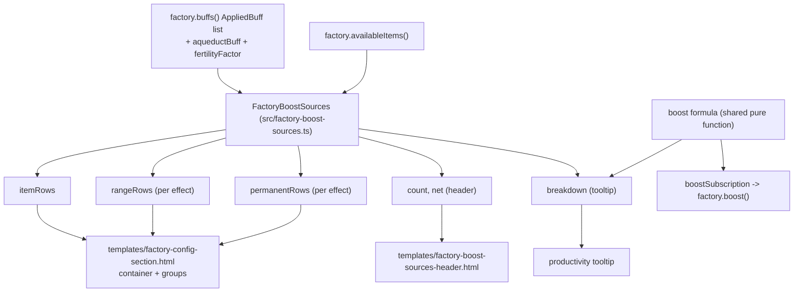

# Factory Effect UX - Plan

## Goal Capsule

- **Objective:** In the factory configuration view, show what drives a factory's productivity in three lean groups (equipped items, range effects, permanent effects) inside one collapsed container, and explain the productivity number on demand (tooltip), without showing every contribution at once.
- **Product authority:** This plan owns the presentation of buff sources inside the factory config section (`templates/factory-config-section.html`, embedded by `templates/product-config-dialog.html:106`). It does not change calculation, persistence, or the Effects dialog's role as the control for global effects.
- **Open blockers:** None. Product forks are recorded under Outstanding Questions with recommendations; the implementation follows the recommendations.
- **Design constraint (user-set):** Lean and collapsible with guidance. Acceptance is measured by AE1-AE4 (default state, group cap, first glance versus on demand).
- **UX reference:** the `#factory` section of the dialog mockups (https://claude.ai/artifact/SCQPogPpKRmREHC1cMbGdk). It fixes the container position (a table row under the productivity row), the header (chevron, "Boost sources", active count, net boost), one guidance sentence, three plain labelled groups, a legend inside the Equipped items group only, and a tooltip of icon and number pairs. Where this plan and the mock differ, this plan governs (see KTD5, KTD6).

---

## Product Contract

### Problem

A player opening a factory sees one number, "Productivity", and cannot tell why it has that value.

- The factory config section shows the boost total (`templates/factory-config-section.html:44-56`) with only aqueduct and module checkboxes beside it (`:58-72`).
- The one collapsible list, "Items Equipped" (`:121`, collapsed by default), holds every toggleable source. `Consumer.addBuff` admits both Items and qualifying building-sourced Effects into the same `items` array (`src/factories.ts:370-380`), so equipped items and a Hippodrome range reward (Chariot and Crew, `+20% productivityUpgrade`) sit in one table under the heading "Items Equipped". A range effect is not an equipped item.
- Global effects (discoveries, veneration, events) reach the factory as `AppliedBuff`s in `buffs()` (`src/factories.ts:207-210`) but are not listed anywhere in the factory view. They are switched in the Effects dialog (`templates/effects-dialog.html`), so a factory boosted by a discovery looks identical to an unboosted one.
- The calculation is invisible. `boost` is `(100 + base) * (100 + sum of productivityUpgrade) / 10000 * fertilityFactor`, floored at `ACCURACY` (`src/factories.ts:199-226`). Base-productivity additions and productivity upgrades combine differently, aqueduct buffs feed in (`:212-216`), and fertility multiplies (`:224-226`). None of this is explained.

### Actors

- **Planner player:** configures an island, opens a factory dialog to check or tune its output.
- **Returning player:** knows the numbers in-game and wants to confirm the calculator agrees.
- **Maintainer:** needs the grouping rule to be derivable from data, not a per-effect list.

### Verified Baseline

- Buff sources and their data fields: `Effect.source` is one of `building`, `tech`, `festival`, `veneration-effect`, `session-event`, `island-event`, `mythical-item` (`src/production.ts:859`, `js/params.js` effects tally). `Effect.effectDuration` is set only when greater than 0 (`src/production.ts:901-902`); in `js/params.js`, only festival, one island-event and two session-event effects carry a duration (8 of 154).
- `effectScope` distinguishes range effects (`Radius`, `StreetDistance`, all `building`-sourced) from island, session, and meta scope (`js/params.js`).
- A building-sourced effect with a production-relevant buff has per-target state in `Effect.slotStates` (`src/production.ts:862-866, 981-1000`); every other parent type has `slotStates` undefined except `Item` (`src/factories.ts:377-380`). Today exactly one effect qualifies (Chariot and Crew), per the related plan `docs/plans/2026-09-19-001-feat-per-building-effect-toggle-plan.md` (Summary).
- Effects have no boost variant: `Effect.boostEquipments` is an empty array (`src/production.ts:869`).
- The factory tile shows modules and aqueduct checkboxes and no buff list (`templates/factory-tile.html:50-66`).
- The collapsible component persists open/closed state per id in localStorage (`src/components.ts:590-596`, `src/views.ts:535-557`) and accepts a `summary` value shown in its header (`src/components.ts:585-586, 613-618`). The summary block renders `formatNumber(summary())` followed by a hard-coded " t/min" (`src/components.ts:651-656`), so it cannot show a count or a percentage.
- Tooltips today are plain `title` attributes (`templates/factory-config-section.html:51`) and `data-toggle="tooltip"` markers that carry a `title` (`templates/factory-tile.html:9`, `templates/product-tile.html:27`); no `.tooltip(` initialisation was found in `src/*.ts`, `index.html` or `templates/*.html`. A `title` cannot hold icons or aligned numbers.
- Aggregate mode: the whole equipped-items block sits inside `ifEditable` (`templates/factory-config-section.html:119`), hidden when All Islands aggregation is on (`AGENTS.md`, All-Islands Aggregation).
- `templates/consumer-config-dialog.html` is not mounted: its include in `index.html:119` is commented out. It carries a second copy of the "Items Equipped" collapsible (`:62-63`, same id `factory-config-equipped-items`) and is dead code for this plan.
- All files under `templates/*.html` are registered by file name through `require.context` (`src/util.ts:19`), so a new partial template needs no registration.

### Comparison With the Planner and the Exchange Format

- The planner computes a productivity breakdown with distinct parts: base, additions to the base, additive productivity parts, multiplier factors (including a fertility share), and the total, each tagged with source kind and source GUID (`C:/dev/Anno-117-Planner/paxplanner/model/sandbox.py:317-351`). Its aqueduct control explains itself through a tooltip listing the buff effects (`paxplanner/ui/dialogs.py:310`). Decision input: the calculator's explanation should list contributions by source kind with the additive-versus-multiplier split, and keep the detail in a tooltip.
- The exchange format models equipped items and per-target effects as separate per-factory lists: `factories` -> `items[]` and `effects[]` (per-target effects switched on) (`C:/dev/anno-117-exchange-format/spec/format.md:82`), range effects per building type as `appliedEffects[]` (`:86`), and empire-wide wonder and discovery effects as `effects.global` (`:47`). Splitting items from per-target (range) effects in the UI matches that data split.
- Mythical-item effects are exchanged as island effects with a scale, never as items on the factory (`spec/conversion-rules.md:34-38`), so they belong to the effect groups, not to "equipped items".

### Requirements

**Groups**

- R1. The factory config section presents buff sources in at most three groups, in this order: **Equipped items**, **Range effects**, **Permanent effects**. No other group exists.
- R2. **Equipped items** lists exactly the rows whose parent is an `Item` (today's "Items Equipped" content minus range effects). Behavior is unchanged: tri-state Off/Base/Boosted toggle, buff values per row, one row per (item, factory) slot. Activating an item that has `heroicEffect` (plan 002 R4, U11) also switches that island effect on; unchecking the item leaves the effect on (R4a).
- R3. **Range effects** lists exactly the rows whose parent is an `Effect` with per-target state (`slotStates != null`). Each row has an Off/On toggle only (no Boosted state, no tri-state legend entry for Boosted), the effect name, and its buff values. The discriminator is the existing data signal, not a GUID list, so a later qualifying effect appears automatically.
- R4. **Permanent effects** lists read-only the effects that currently change this factory's boost: an effect qualifies when its scaling is above 0, it has no `effectDuration`, it is not per-target (R3), and it touches this factory through productivity, base productivity, output, fuel, workforce, fertility, or input replacement. Each row shows the effect name, its source label (`Effect.getSourceText`, `src/production.ts:914-952`), and the buff values it adds to this factory. Rows have no toggle; the control stays in the dialog that owns the effect. A row offers a way to reach that dialog (KD3a). Villa items do not appear in the factory dialog (plan 002 R13).
- R4a. The island-wide effect of an item (`heroicEffect`, source `mythical-item`) has no per-target state and no duration, so it is an ordinary permanent effect: while its value is above 0 and one of its buffs changes this factory, it has a row. Its source line names the item when an item that names the effect through `heroicEffect` is activated on the island (in a factory or a villa), and shows the effect's source label alone (the Effects dialog owns it) when no such item is activated. Unchecking the item therefore leaves the row, because the effect stays on (plan 002 R4); the row's link opens the Effects dialog, where the effect is switched off. The row is never a toggle, so the one-way write of the item and the read-only rule of KD3 do not conflict.
- R5. A group with no rows is not shown (no empty heading). A factory with no range effects shows two groups at most; a factory with nothing active shows none.
- R6. Time-limited effects (with `effectDuration`) are not a group (R1 cap). They contribute to the total as today and appear in the calculation explanation (R9) as one aggregate line.

**Collapsed by default, guidance**

- R7. The groups live in one collapsible container, collapsed by default on first open, reusing the existing collapsible behavior including remembered open/closed state. Its header shows the count of active contributing sources and the net boost from effects and items, so the player can decide whether to expand. Inside the container, each group is a plain labeled block, not a second level of collapsible.
- R8. The container header carries one line of guidance in the player's language that says what the groups are (for example: items are equipped per building, range effects depend on a building nearby, permanent effects come from research and wonders and are set in the Effects dialog). The guidance is visible when the container is open and is not repeated per group.

**Calculation explanation**

- R9. The productivity total in the productivity row has a tooltip, available on hover or focus and nothing visible until then, that shows how the number is built: base productivity (100%), additions to base productivity, the sum of additive productivity upgrades, the resulting product, the fertility multiplier when below 100%, and the total. Contributions are listed per source kind (items, range effects, permanent effects, time-limited effects, modules, aqueduct), not per effect, to keep the tooltip short. The tooltip's total equals the displayed productivity value.
- R10. Each row in R2-R4 has its own tooltip on its buff values stating which field the value changes and whether it adds to base productivity or to the productivity sum (the two are not interchangeable, `src/factories.ts:212-221`). No always-visible formula text.
- R11. When the productivity row is not shown (fertility factor zero, `src/presenters.ts:267-272`), neither the tooltip nor the groups' net boost claims a productivity value.

**Scope, aggregation, localization**

- R12. In All Islands aggregation the groups and the explanation tooltip are hidden, because they describe one island's toggles; the existing read-only aggregate productivity display is unchanged.
- R13. Every new visible string exists in all 12 languages (`src/i18n.ts`, `npm run check-translations`). Existing keys are reused where they fit (`itemsEquipped`, `productivity`, `fertility`, `boostOff`, `boostBase`, `boostBoosted`, effect source labels). Effect and item names come from `params.js` and are already localized.
- R14. Persistence is unchanged: per-target range-effect state keeps its key and values (see Range-Effect State Contract), and permanent effects keep their global storage. Only the open/closed state of the new container is added.

**Supplier tabs (separate from the boost-source work; concerns the factory tabs of the product config dialog)**

- R15. In the supplier tabs of the product config dialog (`ul#product-config-supplier-tabs`), a river embankment factory shows the icon `icons/icon_raw_resource_rivers_2d_0_1.webp` between the region icon and the factory name. A factory without the flag shows no such icon; this includes the five Roman factories with `slotType` River (2970 Clay Pit, 2971 Sturgeon Hatchery, 31753 Gold Washer, 3074 Heavy Roman Glass, 3075 Ingredient Roman Flour), which sit in a river slot, not on an embankment, and whose flag stays false. The flag is the boolean attribute `isRiverEmbankment` of the factory entry in `params.js` (extractor hand-off `C:/dev/asset-extractor/docs/handoff-river-embarkment-factories.md`). The icon appears in single-island and All-Islands views alike. It is an icon-only mark with the title "River embankment" in the player's language (icon-first rule: icon with title, no text), and the icon file is referenced by relative path like other files in `icons/`, not through `params.icons`.

### Scope Boundaries

Non-goals:

- No change to calculation or to the boost formula. A behavior-preserving extraction of the formula into one shared function is allowed (KTD3).
- No change to the factory tile (`templates/factory-tile.html`); it keeps modules and aqueduct only, because effect detail on every tile contradicts the lean constraint.
- No toggling of permanent effects from the factory view, because they are island- or empire-wide and a per-factory switch would misstate their scope.
- No per-effect line items in the productivity tooltip; per-source-kind lines only.
- No residence-side effect presentation (residence-effect dialog). `templates/consumer-config-dialog.html` is not mounted (`index.html:119`) and is not changed.
- No spatial simulation of ranges; a range effect stays a manual per-building toggle (related plan, Problem Frame).
- The 48 residence-only building effects, orphaned mythic specialists, and the Effects dialog layout stay as in the related plan.

### Dependency on the Per-Building Effect Toggle Plan

The toggle plan (`docs/plans/2026-09-19-001-feat-per-building-effect-toggle-plan.md`) is implemented in the working tree (`src/production.ts:862-1000`, `src/factories.ts:370-380`). Its KD3 places range-effect rows inside the "Items Equipped" table. This plan replaces that placement with the separate **Range effects** group (R3) and keeps its data model, persistence key scheme, DLC locking, and the exclusion of building effects from the global dialog untouched. Where the two documents differ on where a range-effect row appears, this plan governs.

### Acceptance Examples

- AE1 (default state). Open the factory dialog for a factory with equipped-item candidates and active research effects on a fresh profile. The container is collapsed; no group heading, row, toggle, or formula is visible; the header shows the source count and net boost. Covers R7.
- AE2 (group cap). Expand the container for a Bakery with the Hippodrome DLC unlocked, an item available, and a discovery active. Exactly three group headings are visible, in the order Equipped items, Range effects, Permanent effects. Covers R1, R5.
- AE3 (split). With Chariot and Crew available for the Bakery, its row appears under Range effects with an Off/On toggle and not under Equipped items; an equipped item such as Favillus appears only under Equipped items with the tri-state toggle. Covers R2, R3.
- AE4 (empty groups). For a factory with no qualifying range effect, no Range effects heading exists; for a factory with nothing active and no items, the container is not shown. Covers R5.
- AE5 (permanent). Activate a discovery that raises productivity for the factory; it appears under Permanent effects with its source label and value and no toggle; deactivating it in the Effects dialog removes the row. A festival with a duration does not appear but changes the total. Covers R4, R6.
- AE10 (heroic effect). A factory item whose `heroicEffect` changes this factory: activating the item in Equipped items adds the effect under Permanent effects with the item named as its source; unchecking the item leaves the row (source line without the item), and the row's link opens the Effects dialog; switching the effect off there removes the row while the item stays equipped. Covers R2, R4, R4a.
- AE6 (explanation). Hovering the productivity total shows base, additive sum, product, fertility (only when below 100%), and total; the total matches the displayed percent. Nothing of this is visible before hover. Covers R9.
- AE7 (persistence). Collapse state survives reload; toggling Chariot and Crew for one Bakery and reloading keeps its state (existing behavior). Covers R7, R14.
- AE8 (aggregation). With All Islands aggregation on and All Islands selected, the container and tooltip are absent. Covers R12.
- AE9 (i18n). `npm run check-translations` passes with the new keys. Covers R13.
- AE11 (river embankment icon). The Aegyptus Barley product shows two supplier tabs named Barley Farm: the riverbank variant (GUID 155404) carries the river icon between region icon and name, the fertile-land variant carries none. No factory without the flag shows the icon. The icon is present in the All-Islands tab strip as well. Covers R15.

Testability summary: default-collapsed (AE1), maximum visible groups equals 3 (AE2), at first glance only the header with count and net boost, on demand the groups and the tooltip (AE1, AE6).

### Key Decisions

- KD1. **One collapsed container, not three collapsibles.** Three headers would put three controls on every dialog; one container with plain labeled blocks inside keeps the first-glance cost to one line. Reuses the collapsible component and its remembered state (`src/components.ts:590-596`).
- KD2. **Split by parent type using the existing data signal** (`Item` versus `slotStates != null`), not by GUID or text, matching the data model that both the toggle plan and the exchange format (`items[]` versus `effects[]`, `spec/format.md:82`) already separate.
- KD3. **Permanent effects are read-only.** Controls remain where scope is correct; the factory view informs and links. Duration is the data signal for "permanent": `effectDuration` unset (`src/production.ts:901-902`). An item switches its `heroicEffect` on (plan 002 U11) but the factory view never switches an effect off: the permanent row stays after the item is unchecked and links to the Effects dialog.
- KD3a. **The link from a permanent effect closes the factory dialog and opens the dialog that owns the effect**, the way existing links do (`templates/settings-dialog.html:25` and `:51`, `templates/treeElement.html:2`: hide the current modal, open the target after 500 ms). Every effect opens the Effects dialog, except patron effects (OQ5). There is no way back to the factory dialog.
- KD4. **Explanation by source kind in a tooltip**, following the planner's breakdown parts (`sandbox.py:326-351`) at lower granularity, because per-effect listing across 154 effects fails the lean constraint.
- KD5. **Aggregate mode hides the new UI** like the existing item block, instead of summing toggles that are per-island.
- KD6. **`templates/consumer-config-dialog.html` is out of scope** because it is not mounted (`index.html:119`).
- KD7. **The river embankment flag is read through one property, `FactoryPresenter.isRiverEmbankment`.** The property returns true when the factory's params entry carries `isRiverEmbankment` set to true; the template binds only the property. The icon is `` with `visible: $data.isRiverEmbankment` and a `title` from the i18n key `riverEmbankment`. The tab strip sits outside `ifEditable`/`ifAggregated` (it renders in both modes), so the icon needs no gate. Only factories with `isRiverEmbankment: true` get the icon; the five Roman factories with `slotType` River (2970, 2971, 31753, 3074, 3075) have the flag false and get none, because the icon marks the embankment variant that shares its display name with a field twin and these factories have no twin.

### Outstanding Questions

- OQ1. Should time-limited effects (festivals, events with duration) get a visible fourth line inside Permanent effects, labeled with the duration? Recommendation: no; keep them in the tooltip aggregate line (R6) to hold the three-group cap, and revisit if players ask where festival boosts went.
- OQ2. Does the unlabeled Equipped items group need a heading when it is the only group? Recommendation: keep the heading; it keeps the layout stable and the container header already carries the guidance.
- OQ3. Should the header's net boost count modules and aqueduct (shown in the productivity row) or only the three groups? Recommendation: only the three groups, so the header number equals the sum of what the container shows; modules and aqueduct stay in the tooltip and productivity row. The implementation follows this (KTD4).
- OQ4. Range-effect toggle control: the mock draws an Off/On switch; the calculator already has `tri-state-toggle`, which cycles Off and Base only when `hasBoost` is false (`src/components.ts:535-538`). Recommendation: reuse `tri-state-toggle` (one control for the same stored state, keyboard handling and element ids unchanged); revisit only if players read the blue check as "item equipped".
- OQ5. Owner dialog of a veneration (patron) effect. `Island.availableEffects` excludes patron effects (`src/world.ts:949-979`, `patronEffects`), so the Effects dialog does not list them; the patron selection dialog (`#patron-selection-dialog`, `index.html:134`) owns them. Recommendation: effects in `island.patronEffects` link to the patron selection dialog, all others to the Effects dialog.
- OQ6. Link target precision. The Effects dialog filters by name only (`src/main.ts:67-77`) and two effects can share a name (Chariot and Crew 174824 and 155840, per `tests/binding/chariot-and-crew-per-building-toggle.spec.ts:79-81`). Recommendation: the link pre-fills the search field with the effect name and the source filter with the effect's source; a guid filter is not added.
- OQ7. Source icon per effect source. Only the Effects navbar icon (`icons/icon_2d_reward_buff_0.webp`) and the patron navbar icon (`icons/icon_2d_religion_belief_0.webp`) are verified (`index.html:131-134`). Recommendation: one effects icon for tech, festival, event and mythical-item sources, the patron icon for veneration; the `getSourceText()` text is the icon's title, no new icon assets.

**Product Contract preservation:** The contract holds R1-R15, R4a and AE1-AE11, the Verified Baseline entries, KD6, KD7 and OQ4-OQ7.

---

## Planning Contract

### Context and Research

Verified by reading the files named; no tests or builds were run.

- Boost formula: `src/factories.ts:199-227` sums `baseProductivityUpgrade()` and `productivityUpgrade()` over every `buffs()` entry (items, boost variants, effects of any scope, module buffs) plus the aqueduct buff, then `(100 + base) * (100 + up) / 10000 * fertilityFactor`, floored at `ACCURACY`. `fertilityFactor` is declared on `Factory` (`src/factories.ts:552`, assigned `:582`) and read through a cast on `Consumer`. Module buffs are summed like all others; the multiplicative remark in `src/AGENTS.md` ("Module buffs are multiplicative") does not match this code.
- `AppliedBuff` (`src/buffs.ts:14-170`): `parent` is `Item | Effect | Module`; observables `baseProductivityUpgrade`, `productivityUpgrade`, `fuelDurationPercent`, `workforceMaintenanceFactorUpgrade`, `fertilityPercent` are the buff value times `scaling()`; `extraGoods`, `replacementArray`, `replacingWorkforce` are plain fields; `activeBuff` is set only for item base equipments and range effects, so permanent rows read `buff` and the scaled observables.
- A range effect with several buffs creates one `AppliedBuff` per buff, each admitted as its own row by `Consumer.addBuff` (`src/factories.ts:377-379`). The current template would show such an effect twice; the new range rows group by effect.
- `isProductionRelevantBuff` (`src/production.ts:831-840`) is the existing "does this buff move a factory field" predicate; it is module-private today.
- Range-effect persistence: `src/world.ts:984-999` persists each slot with `persistInt({ state }, "state", "<targetGuid>[<effectGuid>].scaling")`; the scaling computed clamps to `state() === 1 ? 1 : 0` (`src/production.ts:999-1002`). The exchange layer reads and writes the same key (`src/exchange/keys.ts:18-21`, import `src/exchange/import-islands.ts:325-331` writes `1`, export `src/exchange/exporter.ts:393-411` lists an effect whenever the value is >= 1).
- Dialog navigation precedent: hide the open modal, then `setTimeout(() => $('#<id>').modal('show'), 500)` (`templates/settings-dialog.html:25, 51`; `templates/treeElement.html:2`). Effects dialog id `effects-dialog`, search `view.effectsFilter.search`, source filter `view.effectsFilter.source` (`src/main.ts:63-77`, `templates/effects-dialog.html:14-24`).
- Presenter shape: `FactoryPresenter.instance()` resolves the per-island `Factory`; the template reads `$data.instance().availableItems` today (`templates/factory-config-section.html:120, 138`). Binding to a property of the factory instance avoids a new `with:` over a presenter computed that changes on island switch (pitfall in `templates/AGENTS.md`, "Pitfall discovered").
- Existing tests touching the area: `tests/computed/building-effect-per-target-toggle.spec.ts` (Group C asserts `availableItems` membership, which stays), `tests/binding/chariot-and-crew-per-building-toggle.spec.ts` (selector `#fc-<factory>-<effect>-equipped`, describes the Items Equipped table), `tests/binding/all-islands-aggregation-gating.spec.ts:386-414` (U6 asserts the text "Items Equipped" absent while aggregating and present otherwise), `tests/binding/factory-config-dialogs.spec.ts`, `tests/computed/factory-calculations.spec.ts`, `tests/computed/tristate-boost.spec.ts`.
- Not verified: the exact `baseProductivityUpgrade` population in `js/params.js` (a count query matched one line of a possibly minified file); the tooltip design therefore handles non-zero base additions without assuming they occur. Not verified: Bootstrap tooltip initialisation for `data-toggle="tooltip"` markers.

### Key Technical Decisions

- KTD1. **Derive groups in a new read-only model, leave `Consumer.addBuff` and `items` untouched.** `src/factory-boost-sources.ts` (new) classifies `factory.buffs()` and `availableItems()`; existing tests that assert `availableItems()` membership keep passing. The model is exposed as `Consumer.boostSources`, created on first access, so templates bind `$data.instance().boostSources` (the same access path as `availableItems`).
- KTD2. **Classification table.** One rule per `AppliedBuff.parent`, used by rows, count, net and tooltip alike:

  | Parent | Condition | Group | Tooltip line |
  |---|---|---|---|
  | `Item` (base or boost variant) | row = base equipment in `availableItems()`; boost variants contribute only to the sums | Equipped items | items |
  | `Effect` | `slotStates != null` | Range effects (rows grouped per effect) | range effects |
  | `Effect` | no `slotStates`, no `effectDuration`, `scaling() > 0`, `isProductionRelevantBuff(buff)` (this includes the effect an item names through `heroicEffect`, R4a) | Permanent effects (rows grouped per effect) | permanent effects |
  | `Effect` | `effectDuration` set | none | time-limited effects |
  | `Module` | any | none | modules |
  | aqueduct buff | `aqueductBuff != null` | none | aqueduct |

- KTD3. **One formula, two callers.** Extract the productivity formula (`(100 + base) * (100 + up) / 10000 * fertility`, floored at `ACCURACY`) into one exported pure function in `src/factories.ts`, called by `boostSubscription` and by the breakdown. Behavior-preserving; the parity test (U1) fails if the two ever diverge. The model never writes `boost`.
- KTD4. **Header numbers.** Count = rows with state above 0 in Equipped items and Range effects plus rows in Permanent effects. Net = sum over those same rows of `productivityUpgrade + baseProductivityUpgrade` in percentage points, so the header equals the sum of the values shown in the rows (OQ3). The tooltip carries the exact arithmetic; the header number is therefore labelled by its title as the net of items and effects before modules, aqueduct and fertility. When the productivity row is hidden (R11) the net is not rendered and the count is.
- KTD5. **Container is a table row under the productivity row, outside the productivity `ko if`.** The row `<tr><td colspan="3">` sits after the productivity block, inside `ifEditable` and an `if` on "any group has rows or any item is available". When the productivity row is hidden the container still renders, under the preceding rows, without the net. This follows the mock's position (R7 states no position) and keeps R11.
- KTD6. **Collapsible gains an optional `headerTemplate` param.** The existing `summary` block cannot render a count or percent (hard-coded " t/min"). The param names a registered template rendered inside the legend with `data`; callers without it are unchanged. The header template is `templates/factory-boost-sources-header.html` (icon and number pairs, each with a `title`). The container uses the new id `factory-config-boost-sources`, collapsed by default; the old id `factory-config-equipped-items` is left in storage unmigrated (it is also used by the unmounted consumer dialog).
- KTD7. **Tooltip is a CSS popover, not a `title`.** A `title` cannot carry icons or aligned numbers and does not open on keyboard focus or touch. The productivity value becomes a focusable element (`tabindex="0"`, `aria-describedby`) with a sibling `role="tooltip"` block shown on `:hover`, `:focus-visible`, and a click pin; styles go to `style.css`. Rows inside are icon and number pairs; every icon has a `title`, the root has an `aria-label` with the sentence form (R9: nothing visible before hover). Rows with value 0 are omitted; the fertility row appears only below 100 %.
- KTD8. **Row values use one shared partial.** The buff-value block (base productivity, productivity, fuel, extra goods, input replacement, workforce maintenance, workforce replacement, fertility; `templates/factory-config-section.html:153-203`) moves into `templates/factory-buff-values.html` and is rendered by all three groups through `template: { name: 'factory-buff-values', data: ... }`. Permanent and range rows feed it a row object with the same field names as the `activeBuff()` accessors (aggregated per effect), which also satisfies R10: each value carries a `title` naming its field, and base-productivity values state that they add to the base. The existing titles use `productivity` for both fields (`:154, :159`); base additions get a distinct title (new key).
- KTD9. **Navigation lives in the presenter.** `FactoryPresenter.openEffectSource(row)` hides `#product-config-dialog`, pre-fills `view.effectsFilter` for the Effects dialog (OQ6) or opens `#patron-selection-dialog` (OQ5), then shows the target after 500 ms, using the existing pattern. One resolver function maps a row to its owner: an effect in `island.patronEffects` resolves to `'patron'`, the rest to `'effects'`.
- KTD10. **Row ids stay.** Toggle ids keep the scheme `fc-<targetGuid>-<parentGuid>-equipped` for items and range effects, so existing selectors keep working.

### Range-Effect State Contract (for plan 2026-11-14-001 R25)

The calculator stores one state per (range effect, target building type), not per building instance and not a share or scale.

| Aspect | Value |
|---|---|
| Store | per-island `Storage` JSON (`new Storage(islandName)`), not `window.localStorage` |
| Key | `<targetGuid>[<effectGuid>].scaling`; `targetGuid` is the production building type GUID (a `Factory.guid`), `effectGuid` the `Effect.guid`. Builder: `keys.factoryEffectScaling(factory, effect)` (`src/exchange/keys.ts:21`) |
| Value | raw integer 0 or 1 (`persistInt`, `src/world.ts:994-998`); any other stored value acts as Off (`src/production.ts:1000`) |
| Which effects have a key | effects with `source === 'building'` and a production-relevant buff (`slotStates != null`); for every other effect the key is not used (`src/world.ts:984-988`) and `island.effect.<guid>.scaling` applies instead |
| Valid targets | only the effect's `targets` (the keys of `slotStates`); an effect or target outside that set has no state to set |
| DLC | writing a non-zero state auto-enables the effect's DLC (`lockDLCIfSet`, `src/production.ts:989`) |
| Export | state >= 1 lists the effect GUID in `factories[f].effects[]` (`src/exchange/exporter.ts:409-410`) |

Import mapping of `appliedEffects[]` entries `{type, effect, source, share, applied, method, scale}` (spec `format.md:86`). The mapping is applied by plan 2026-11-14-001 R25 and stated there; it relies on this contract only:

- `type` selects the target factory GUID, `effect` the effect GUID. An entry whose effect is not a range effect (no `slotStates`) or whose `type` is not one of its targets has no state to set and stays kept at its pointer.
- `applied === true` writes 1 to `<type>[<effect>].scaling`; `applied === false` writes 0.
- `share` below 1 and above 0 cannot be represented (the state is per building type); the entry is applied by `applied` and the approximation is recorded in `ImportPlan.report` only (no UI).
- `scale` and `method` have no calculator counterpart and are carried in `exchange.ext`, not applied.
- The existing `factories[f].effects[]` import writes the same key with value 1; R25 reuses `keys.factoryEffectScaling` and `noteDlc`.

### High-Level Technical Design

Tooltip rows, in order (omit zero rows): base 100 %, base additions (sum of `baseProductivityUpgrade` over every source), items, range effects, permanent effects, time-limited effects, modules, aqueduct, sum (`(100 + base) * (100 + up) / 100` as a percent), fertility factor (below 100 % only), total. The total is the shared formula's result and equals `factory.boost()` within `ACCURACY`.

### Implementation Units

Sequencing: U1 -> U2 -> U4 -> U6; U3 and U5 are independent of U1 and U2 and must land before U4's template can be exercised. U7 (supplier tab icon) is independent of U1-U6 and shares only `src/i18n.ts` with U5.

#### U1. Boost-source model and shared formula

**Goal:** Classify buffs per KTD2 and compute rows, count, net and breakdown, with the formula shared with `boostSubscription`.

**Requirements:** R2, R3, R4, R6, R9, R11; AE5, AE6.

**Dependencies:** none.

**Files:**
- `src/factory-boost-sources.ts` (new)
- `src/factories.ts` (extract formula; add lazy `Consumer.boostSources`)
- `src/production.ts` (export `isProductionRelevantBuff`)
- `tests/computed/factory-boost-sources.spec.ts` (new)

**Approach:**
- Row objects: item row (the base `AppliedBuff`, as today), range row and permanent row (one per `Effect`: name, `getSourceText()`, scaled sums of the five numeric observables, concatenated `extraGoods`, `replacementArray`, `replacingWorkforce`, stack count `scaling()` for stackable effects).
- All outputs are `pureComputed` over `buffs()`; groups are arrays inside the model, never swapped arrays on a bootstrap `foreach` (the dialog is exempt, but the rule costs nothing here).
- Permanent rows add `owner` from the single resolver of KTD9 (`'effects' | 'patron'`), default `'effects'`, and `equippedBy` (the `Item` whose `heroicEffectGuid` equals the effect's GUID and that has a slot state or villa state above 0 on the island, undefined otherwise; plan 002 KTD16). The row shows the item name when `equippedBy` is set and the source label otherwise.
- Breakdown returns plain numbers per kind and the final total from the shared formula; `fertilityFactor` is read the way `boostSubscription` reads it.

**Execution note:** Test-first: write the parity test (breakdown total equals `factory.boost()`) before the model.

**Patterns to follow:** `Consumer.availableItems` (`src/factories.ts:172`), `AppliedBuff` scaled observables (`src/buffs.ts:99-119`).

**Test scenarios:**
- Happy path. Covers AE6. Bakery (3174, Latium) with no sources: breakdown total equals `boost()` (1.0); only the base row exists.
- Parity. Item at Base, item at Boosted (Favillus 50890 on Furnace 3070), Chariot and Crew on (DLC 67903 checked), aqueduct on, a module on where available: `breakdown.total` equals `factory.boost()` within `ACCURACY` for each combination.
- Parity with fertility below 100 % (a factory with `neededFertility` and the fertility unchecked on the island): fertility row present, total still equals `boost()`.
- Classification. Chariot and Crew appears in range rows and not in item rows; Favillus in item rows only; a `tech` effect with `productivityUpgrade` targeting the factory (find it by scanning `params.effects`, do not hardcode a GUID) with `scaling(1)` appears in permanent rows with its `getSourceText()`; with `scaling(0)` it does not.
- Time-limited. A festival effect with `effectDuration` and `scaling(1)` is in no group, adds to the time-limited line, and the total still equals `boost()`.
- Heroic effect (R4a). An item with `heroicEffect` that reaches the factory (derive the pair from `params.items` and `params.effects`, for example 160048 -> 166439 and its factory targets): before activation no row; with the item at Base the effect is in permanent rows and `equippedBy` is the item; with the item at Off again the row stays with `equippedBy` undefined; `effect.scaling(0)` removes the row while the item state stays unchanged; the breakdown total equals `boost()` in each step.
- Edge: an effect with two buffs on one factory yields one row whose values are the sums of both buffs.
- Edge: a stackable effect with `scaling(2)` doubles the row values.
- Edge: an effect on all production whose buffs change nothing production-relevant (consumption only) yields no permanent row.
- Edge: `slotStates` value 2 on a range effect (corrupt save) contributes nothing and the row shows Off.
- Header. Count and net for item Base (+x), Chariot on (+20), one permanent effect (+y): count 3, net equals x + 20 + y; with all off: count 0.
- Error path: a factory without `aqueductBuff` and without `fertilityFactor` (a non-factory consumer) yields a breakdown without those rows and no exception.

**Verification:** the parity and classification scenarios pass; `tests/computed/factory-calculations.spec.ts` and `tests/computed/tristate-boost.spec.ts` still pass (formula extraction is behavior-preserving).

#### U2. Presenter navigation and owner resolver

**Goal:** Give the template one call for "open the dialog that owns this effect".

**Requirements:** R4, KD3a.

**Dependencies:** U1.

**Files:**
- `src/presenters.ts` (`FactoryPresenter.openEffectSource`)
- `src/factory-boost-sources.ts` (owner resolver)
- `tests/binding/factory-boost-sources.spec.ts` (new, shared with U4 and U6)

**Approach:** Hide `#product-config-dialog`, set `view.effectsFilter.search(effect.name())` and `view.effectsFilter.source(effect.source)` (restricted to the values the select offers; `'all'` otherwise) for owner `'effects'`, then `setTimeout(show, 500)`. Owner `'patron'` shows `#patron-selection-dialog`.

**Patterns to follow:** `templates/settings-dialog.html:25`, `templates/treeElement.html:2`.

**Test scenarios:**
- Happy path. Clicking the link on a `tech` permanent row closes `#product-config-dialog`, opens `#effects-dialog`, and the search field holds the effect name and the source filter its source.
- Edge: an effect with source `building` or `mythical-item` leaves the source filter at `all` when the select has no matching option.
- Edge: a patron effect opens `#patron-selection-dialog` (find one through `island.patronEffects`).
- Integration: after the redirect the Effects dialog lists the effect (assert via `view.filteredEffects()` containing it); for a patron effect this assertion is skipped because the dialog does not list it.

**Verification:** both navigations work without binding errors (`BindingErrorDetector`).

#### U3. Collapsible `headerTemplate` param

**Goal:** Let a collapsible header render a template (count and net) without the hard-coded " t/min" summary.

**Requirements:** R7; KTD6.

**Dependencies:** none.

**Files:**
- `src/components.ts` (collapsible viewModel and template)
- `templates/AGENTS.md` (document the param under "Collapsible Section")
- `tests/binding/collapsible-header-template.spec.ts` (new)

**Approach:** Read `params.headerTemplate`; render `template: { name: headerTemplate, data: data }` inside the legend after the heading, only when set. No change to `summary`, checkbox, external link, or persistence.

**Test scenarios:**
- Happy path: a collapsible with `headerTemplate` shows the template content in the legend and toggling it still persists the state in `collapsibleStates`.
- Regression: existing collapsibles (`product-config-consumption`, `factory-config-production-chain`) render the `summary` with " t/min" unchanged and bind without errors.
- Edge: clicking inside the header template toggles the collapse (the legend is the toggle target).

**Verification:** `tests/binding/factory-config-dialogs.spec.ts` still passes.

#### U4. Template restructure and tooltip

**Goal:** Replace the "Items Equipped" collapsible with the Boost sources container and add the productivity tooltip.

**Requirements:** R1-R3, R5, R7, R8, R10-R12; AE1-AE4, AE6, AE8.

**Dependencies:** U1, U2, U3, U5.

**Files:**
- `templates/factory-config-section.html` (container row, three groups, tooltip wrapper)
- `templates/factory-buff-values.html` (new shared partial)
- `templates/factory-boost-sources-header.html` (new)
- `style.css` (`.prod-tip` popover, group heading, row layout)
- `tests/binding/factory-boost-sources.spec.ts`
- `tests/binding/chariot-and-crew-per-building-toggle.spec.ts` (heading text and "table" wording)
- `tests/binding/all-islands-aggregation-gating.spec.ts` (U6 case: the asserted text becomes the new container heading, still absent while aggregating)

**Approach:**
- Container: one `<tr><td colspan="3">` after the productivity block, wrapped in `<!-- ko ifEditable: true -->` (never `visible:`) and an `if` on whether any group has rows; `collapsible` with `id: 'factory-config-boost-sources'`, `collapsed: true`, `headerTemplate`, `data: $data.instance()`.
- Body: guidance paragraph once (icon with `title`, sentence), then three blocks each guarded by `if: rows().length` (R5). Equipped items keeps the tri-state legend, the existing `tri-state-toggle` rows over item rows, and the `external-link` to `items` moves into this group's heading. Range effects reuse `tri-state-toggle` with `hasBoost: false` (OQ4), the house icon with a `title` stating that a building nearby is needed, and the shared partial. Permanent effects: source icon with `getSourceText()` title, name, stack count when above 1, link button (`title` and `aria-label`, `click: $parents[...].openEffectSource`), shared partial; no toggle and no Bootstrap `custom-control` classes on read-only rows (read-only checkbox-shape pitfall in `templates/AGENTS.md`).
- Productivity cell: inside `ifEditable` the value becomes the tooltip trigger with the breakdown block; inside `ifAggregated` the existing plain value stays. The tooltip block is under the same `isProductivityVisible()` condition as the row (R11).
- Do not remove the `consumer-config-dialog.html` copy.

**Patterns to follow:** `templates/AGENTS.md` (ifEditable/ifAggregated, `with:` pitfall, `title` on every icon, colon syntax for params); existing item row markup `templates/factory-config-section.html:138-206`.

**Test scenarios:**
- Covers AE1. Fresh profile, Furnace (3070, items available) with an active research effect: the container exists, the collapse is closed, no group heading is visible, the header shows count and net.
- Covers AE2. Bakery with the Hippodrome DLC checked, an item available and a discovery active: expanded, exactly three group headings in the order Equipped items, Range effects, Permanent effects.
- Covers AE3. Chariot and Crew's toggle (`#fc-3174-174824-equipped`) is inside the Range effects block and its legend shows no Boosted glyph; Favillus' toggle is inside Equipped items; clicking the range toggle cycles Off/On only, state 0 -> 1 -> 0.
- Covers AE4. A factory without range effect has no Range effects heading; a factory with no items and nothing active has no container element.
- Covers AE5. A permanent row shows name and source label, contains no input or `tri-state-toggle`; setting its effect scaling to 0 removes the row; a festival with a duration never appears.
- Covers AE10. Toggle the tri-state of an item that has `heroicEffect` to Base in the Equipped items group: a permanent row for the effect appears and names the item; toggle it to Off: the row stays and its source line shows the source label only; click the row's link: `#product-config-dialog` closes and `#effects-dialog` opens with the effect name in the search field; set the effect scaling to 0 there: the row disappears while the item state is unchanged.
- Covers AE6. Focusing the productivity value makes the tooltip visible and hover does too; before that its computed visibility is hidden; the total in the tooltip equals the displayed percent.
- Covers AE8. With `aggregateAllIslands` on and All Islands selected: no `.factory-config-section` container row, no tooltip element, no binding errors; off-aggregate the container is present (extends `all-islands-aggregation-gating.spec.ts` U6).
- Edge (R11): a factory with fertility factor 0 hides the productivity row and the tooltip; the container header shows the count and no net.
- Edge: every icon in the container and tooltip has a non-empty `title` (query `img` and icon elements inside the container).
- Edge: row buff values show the base-productivity title distinct from the productivity title.
- Integration: no Knockout binding errors when switching islands with the dialog open (`BindingErrorDetector`).

**Verification:** the listed specs pass when run one at a time (never concurrently), after `npm run build`.

#### U5. Translations

**Goal:** Add the new strings in all 12 languages.

**Requirements:** R13; AE9.

**Dependencies:** none.

**Files:**
- `src/i18n.ts`

**Approach:** Check `src/i18n.ts` and `window.view.texts` (params translations) for an existing key before adding: reuse `itemsEquipped` (group heading), `productivity`, `fertility`, `boostOff`, `boostBase`, `boostBoosted`, the effect and item names, `buff.name` for the aqueduct line, `Module.name` for modules. This plan owns the keys below. New keys: `boostSources`, `rangeEffects`, `permanentEffects`, `boostSourcesGuidance`, `boostSourcesActiveCount` (title), `boostSourcesNet` (title), `rangeEffectNeedsBuilding`, `openEffectsDialog`, `openPatronDialog`, `boostBaseAddition`, `boostTimeLimitedEffects`, `boostSumOfUpgrades`, `productivityBreakdown` (aria label). Use `simplified_chinese` and `traditional_chinese`, never `chinese`; add each key with English, then `/translate <key>`.

**Test expectation:** none for scenarios beyond `npm run check-translations` (AE9); a binding assertion that no rendered new string is empty belongs to U4's title-presence scenario.

**Verification:** `npm run check-translations` passes.

#### U6. Regression sweep, persistence and documentation

**Goal:** Prove persistence and aggregation parity, then record the new structure in the agent docs.

**Requirements:** R12, R14; AE7, AE8.

**Dependencies:** U4.

**Files:**
- `tests/computed/building-effect-per-target-toggle.spec.ts` (unchanged expectations; run as regression)
- `tests/binding/factory-boost-sources.spec.ts`
- `src/AGENTS.md` (new "Factory boost sources" section; correct the stale "Module buffs are multiplicative" remark)
- `templates/AGENTS.md` (group structure, shared partial, tooltip)
- `tests/AGENTS.md` (selectors and fixtures for the container)

**Test scenarios:**
- Covers AE7. Collapse the container, reload: still collapsed; open it, reload: still open (`collapsibleStates` key `factory-config-boost-sources`).
- Covers AE7. Toggle Chariot and Crew for the Bakery, reload: state 1 restored; the island Storage key `3174[174824].scaling` holds the number 1.
- Persistence contract: seeding the island Storage with `3174[174824].scaling = 1` loads the Bakery with the effect On and the DLC checked; seeding the value 2 loads Off.
- Integration: `Island.availableEffects` still excludes the building effect (existing test) and `availableItems()` still contains the effect row (existing test), so no model change leaked.

**Verification:** regression specs pass sequentially; docs describe the final structure.

#### U7. River embankment icon in the supplier tabs

**Goal:** Show the river icon in the tab of each river embankment factory (separate from the boost-source work; it touches the tab strip of the product config dialog, not the factory config section).

**Requirements:** R15; AE11.

**Dependencies:** the extractor hand-off `C:/dev/asset-extractor/docs/handoff-river-embarkment-factories.md`. Until `params.js` carries the flag, no factory shows the icon; no placeholder, no name-prefix fallback in the calculator.

**Files:**
- `templates/product-config-dialog.html` (icon between the region icon on line 86 and the name on line 87)
- `src/presenters.ts` (`FactoryPresenter.isRiverEmbankment`, the one place that names the attribute; `FactoryPresenter` holds `factory`, `src/presenters.ts:28`)
- `src/factories.ts` (`Factory` reads the flag from its config next to `needsFuelInput`, `src/factories.ts:97`, if the presenter cannot reach the params entry directly)
- `src/i18n.ts` (key `riverEmbankment`, 12 languages)
- `js/params.schema.json` (add the optional boolean property to the `factories` entries, not to `required`, then run `npm run generate-types` to refresh `src/types.config.ts`; never edit `types.config.ts`). The schema must carry the property `isRiverEmbankment` because the types are generated from it.
- `tests/computed/river-embankment-flag.spec.ts` (new)
- `tests/binding/river-embankment-tab-icon.spec.ts` (new)

**Approach:** Add the `` with `visible: $data.isRiverEmbankment` inside the existing `d-flex align-items-center` span of the tab button. The tab strip has no `ifEditable`/`ifAggregated` branch, so the icon renders in single-island and All-Islands views without a gate. Run `npm run type-check` after the schema change.

**Test scenarios:**
- Computed. `isRiverEmbankment` is true for a factory whose params entry sets `isRiverEmbankment: true`, false for an entry without it, false for an explicit `false`.
- Binding, Covers AE11. In the product dialog of a product with a flagged factory and an unflagged twin, the icon is present exactly in the tabs of flagged factories (count equals the number of flagged visible factories) and absent from all others; its `title` equals the localized "River embankment"; it sits between the region icon and the name in DOM order.
- Binding. With All Islands selected, with and without aggregation, the icon is present for the same factories.
- Edge. A tab for a factory in a product with no flagged factory has no `img[src$="icon_raw_resource_rivers_2d_0_1.webp"]`.
- The binding spec builds its flagged factory by setting the flag on a params entry in the fixture when `params.js` does not carry the attribute yet.

**Verification:** `npm run type-check`, `npm run check-translations`, and both specs pass, run one at a time after `npm run build`.

### System-Wide Impact

- Calculation code changes only by the behavior-preserving formula extraction (KTD3); minimization and calculation specs are the guard.
- `Consumer.boostSources` is created lazily; no cost for factories whose dialog is never opened.
- Exchange: no change. State keys and export/import mapping are untouched (Range-Effect State Contract).
- Aggregation: the whole new block is behind `ifEditable`; `ifAggregated` keeps the existing aggregate productivity text.
- The unmounted `consumer-config-dialog.html` keeps its own copy of the old block; deleting it is a separate cleanup.

### Risks and Dependencies

- Formula drift between the shared function and the displayed total: mitigated by one function and the parity tests (U1).
- Knockout reactivity on island switch inside the dialog: bind to `$data.instance().boostSources` rather than a `with:` over a presenter computed (`templates/AGENTS.md` pitfall); U4 includes an island-switch binding check.
- Header net is a percentage-point sum while the formula multiplies; the tooltip is exact, the header title says what it sums (KTD4). Revisit if players compare the header to the tooltip.
- Persisted key `factory-config-equipped-items` stays in `collapsibleStates` as dead state; harmless.

### Cross-Plan Dependencies and Assumed Interfaces

- **2026-11-14-001 import scopes, R25 and sequence:** R25 consumes the Range-Effect State Contract above and states the `appliedEffects[]` mapping. This plan does not change the key, the value domain or the export. The merge order of all plans is "Sequence across plans" in that plan (this plan is step 6). The "Modifiers" scope row that names range-effect state refers to the per-target state of this contract. This plan has no import report lines.
- **2026-11-12-002 residence items, R4, R13 and U11:** one data interface. An item with `heroicEffect` switches that island effect on when it is activated (factory dialog, villa dialog or import) and never switches it off; the stored value is `island.effect.<guid>.scaling` = 1. Every effect with `Effect.scaling() > 0` is an ordinary permanent effect of the Effects dialog (R4, R4a), whether an item or the dialog switched it on; `Item.heroicEffectGuid` (002 KTD16) supplies `equippedBy`. Villa items never appear in the factory dialog.
- **2026-11-12-001 governor suppliers and 2026-11-12-003 DLC settings:** no interface. Plan 003's volcano level changes effect scalings (and therefore permanent rows) through the existing effect storage; this plan reads `scaling()` and needs nothing from it.
- **Extractor hand-off, river embankment flag (U7):** `C:/dev/asset-extractor/docs/handoff-river-embarkment-factories.md`. The calculator needs the boolean attribute in every `factories` entry of `params.js`. No other plan touches the supplier tab strip or this attribute. U7 edits `templates/product-config-dialog.html`, which plan 2026-11-14-001 U4 also edits (different lines: the tab button versus the import area); the file-ownership table in that plan lists both.
- **2026-09-19-001 per-building effect toggle:** its KD3 placement is superseded here (Dependency section above).

### Verification Contract

Run after `npm run build`, one Playwright invocation at a time with `--reporter=list`:

1. `npm run type-check` and `npm run build` succeed.
2. `npm run check-translations` passes (AE9).
3. `tests/computed/factory-boost-sources.spec.ts`, `tests/computed/factory-calculations.spec.ts`, `tests/computed/tristate-boost.spec.ts`, `tests/computed/building-effect-per-target-toggle.spec.ts` pass.
4. `tests/binding/factory-boost-sources.spec.ts`, `tests/binding/collapsible-header-template.spec.ts`, `tests/binding/chariot-and-crew-per-building-toggle.spec.ts`, `tests/binding/all-islands-aggregation-gating.spec.ts`, `tests/binding/factory-config-dialogs.spec.ts` pass with no Knockout binding errors.
5. Manual: open a Bakery with Hippodrome DLC, an item and a discovery; check the collapsed header, the expanded groups, the tooltip on hover and on keyboard focus, the permanent-effect link, dark mode.

### Definition of Done

- AE11 covered by the binding spec of U7 (data-dependent on the extractor hand-off).
- AE1-AE10 each covered by a passing test or the manual check (AE1/AE2 visual density).
- No change to `dist/calculator.bundle.js` committed (release-only rule in `AGENTS.md`).
- `src/AGENTS.md`, `templates/AGENTS.md`, `tests/AGENTS.md` describe the final structure.
- Open questions OQ1-OQ7 resolved by the recommendations or an explicit product decision.

### Sources

- `src/factories.ts`, `src/production.ts`, `src/buffs.ts`, `src/presenters.ts`, `src/components.ts`, `src/world.ts`, `src/main.ts`, `src/util.ts`
- `src/exchange/keys.ts`, `src/exchange/import-islands.ts`, `src/exchange/exporter.ts`
- `templates/factory-config-section.html`, `templates/effects-dialog.html`, `templates/settings-dialog.html`, `templates/treeElement.html`, `templates/consumer-config-dialog.html`, `index.html`
- `docs/plans/2026-09-19-001-feat-per-building-effect-toggle-plan.md`, `docs/plans/2026-11-12-002-feat-residence-items-plan.md`, `docs/plans/2026-11-14-001-feat-import-scopes-plan.md`
- UX mock: https://claude.ai/artifact/SCQPogPpKRmREHC1cMbGdk (`#factory`)
