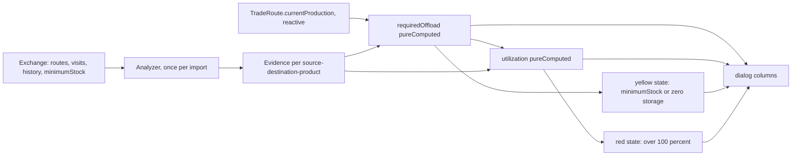

---
title: Trade Route Indicators - Plan
type: feat
date: 2026-11-15
artifact_contract: ce-unified-plan/v1
artifact_readiness: implementation-ready
product_contract_source: ce-plan-bootstrap
execution: code
---

# Trade Route Indicators - Plan

## Goal Capsule

- **Objective:** Players see, per trade route in the trade dialog, how many tons must be unloaded per visit to keep the destination supplied and how much of the route's cargo that takes, and are warned when the game's route configuration or storage history cannot deliver it.
- **Means:** Combine the imported game routes, visits and storage history (exchange document) with the calculator's live route rates through a lazy chain of Knockout computeds (KTD1, KTD2).
- **Authority:** The user request, project instructions and the exchange-format contract.
- **Stop conditions:** No yellow or red indicator when route matching, clock units or evidence is insufficient; show an unavailable state with a reason. The existing source-production indicator is not changed.
- **Execution profile:** One pull request, no release bundle. The implementer owns verification; the pretest (U4) runs in a subagent.

## Product Contract

### Summary

The trade-routes dialog gets two columns next to the existing amount column: **Required offload** (yellow indicator) and **Utilization** (red indicator). The third indicator, the red triangle shown when the source island's production cannot cover the route (`isHighlightedAsMissing` on the source product), stays as it is.

### Requirements

**Columns**

- R1. Required offload: tons that must be unloaded at the destination per visit to sustain the destination's demand through the longest gap between two visits. It is shown beside the actual unload per visit and may be higher (too little shipped) or lower (remote stock fills the gap).
- R2. Utilization: required offload divided by the route's cargo capacity for the product, as a percentage. For consecutive unloads of one good the capacity is the unload slot amount times the ship count. A red indicator appears when the required offload exceeds the capacity (utilization over 100 %).
- R3. Yellow indicator on the offload column when (a) the minimum stock (`minimumStock`) at a station that loads the product is too low to bridge the gap or leaves too little to load, or routes competing for the same source stock leave a destination short (see KTD9), or (b) too few goods were unloaded and the island storage dropped to zero in the storage history. Both states carry a descriptive tooltip.
- R4. The source-production indicator keeps its behavior, placement and condition.

**Reactivity**

- R5. Both columns and both indicators update in the same view update when demand, residences, buildings or route amounts change, without re-importing the file.
- R6. Opening the dialog evaluates only visible rows; closed-dialog edits cost nothing.

**Evidence and uncertainty**

- R7. Game routes are matched to a calculator route by source island, destination island and product; slot `load` is the source, `unload` the receiver. Relay stops are simulated in station order with ship cargo slots and ship count.
- R8. Visit `goods` are net amounts. A stop that loads and unloads the same good is not read as gross unload.
- R9. Required offload needs at least three usable inter-visit gaps with one clock; otherwise both columns show unavailable with a reason. Visit entries exist only for visits with a non-zero net, so gaps are taken from the distinct visit times of the whole route (any station and good) and tooltips mark them as estimates.
- R10. Several game routes serving one destination and product are combined before the red state is decided.
- R11. Tooltips are reachable by keyboard focus and pointer and state the destination, product, gap, tonnage and basis. All labels exist in the 12 calculator languages.

**Product tile and game-route view**

- R12. For an imported product, the tile shows a game-trade-route icon with the red and yellow indicators of its routes in the supplier/factory-count area; locally produced products keep their factory count there.
- R13. The trade dialog has two tabs, Calculator routes and Game routes (read-only, imported game routes with their ordered stops). One shared filter bar above both tabs holds an island filter, a good filter and a warnings-only toggle, and stays when the tab changes. The unset entry of both filters reads "No filter"; "All Islands" is a reserved island name and is not used as a label. The island filter includes a route when the island is source or destination for the selected good at any stop. The tab labels show the red and yellow counts.
- R14. Sorting uses the column headers (click to sort, click again to reverse, `aria-sort` on the header), shared by both tabs where the columns exist. Calculator routes sort by source island, destination island, good, required offload, utilization and route amount; game routes sort by route name, source island, destination island and status. Island sort keys use the alphabetically first matching island for the selected good, or across all goods without a good filter. Filtering and sorting never change indicator calculations.
- R16. A calculator route row shows a chip with the game-route icon and the number of matching game routes; clicking it opens the Game routes tab filtered to that source, destination and good. A game-route stop shows the reverse chip to the Calculator routes tab. A dismissible chip in the filter bar names the jump and returns to the previous filter. Island names keep their existing click action (open the product dialog).
- R17. The dialog uses the extra-large modal width and a sticky header with the filter bar.
- R18. A game route that collects a good at several islands yields one calculator route per source (every source serves every unload slot; sources loading the same slot index serve it). The unload slots of a game route and destination count once for all its sources. After an import the receiver's demand is split once across these routes by source production (KTD10); the trade routes dialog offers "Recompute shares" to repeat it.
- R15. Route direction is verified on the Marcia 73 samples: no re-derived supplier edge is reversed against a planner-listed edge; unmatched transfers are reported as topology differences.

### Scope Boundaries

- **Included:** The two columns, their indicators and tooltips; analysis of imported game routes including relay and mixed cargo; filters and sorting for both route lists; tab navigation with cross-link chips; fixtures; pretest on the sparse Marcia 73 sample and on the Marcia 76 save.
- **Also included (product tile and game-route view):** a game-trade-route icon with the red/yellow indicators in the supplier area of imported product tiles, and a read-only game-route section in the trade dialog with island and good filters and source/destination sorting.
- **Deferred:** A schedule or travel-time simulator for routes without visit history; per-ship tracking; seasonal production forecasts; diagnosing source-side shortage.
- **Excluded from scoring:** Latium arable products hit by volcanic winter, and goods known to be short despite normal modeled production.

### Acceptance Examples

- AE1. Uxoriosum (area 9603) Head Piece (31704) has zero stock in all 12 snapshots, no consumption and no recorded delivery. Required offload is 0 and no yellow shows.
- AE2. Sepat des Platanenwurzel (26308) Statuettes (145220) are served by routes 48 and 93. Utilization uses the combined capacity of both routes; neither is marked red for failing to cover the full deficit alone.
- AE3. Route 66 visits area 9795 twice per circuit. If the two station mappings give different offload or utilization, both columns are unavailable for that row.
- AE4. Raising a residence count raises the route's required offload and utilization in the open dialog; crossing 100 % turns red; lowering it clears the indicator.
- AE5. A route with fewer than three usable gaps shows unavailable in both columns; the source-production indicator is unaffected.
- AE6. A relay stop with the same product in load and unload slots uses slot flow and cargo state, not the net visit amount.
- AE7. A station minimum stock below the required offload shows yellow with the (a) tooltip; a destination at zero storage with unload below the requirement shows yellow with the (b) tooltip.
- AE8. Keyboard focus on an indicator exposes its state and explanation.
- AE9. An imported product tile shows the game-trade-route icon with its indicators in the supplier area; a locally produced product keeps its factory count.
- AE10. Filtering the game-route section by island includes a multi-stop route when that island is source or destination for the selected good at any stop; filtering by good excludes routes without it.
- AE11. Sorting by source or destination uses the alphabetically first matching island (all route goods when no good filter); changing filters leaves the warnings unchanged.
- AE12. The corrected Marcia 73 samples re-derive no edge opposite a planner-listed edge.
- AE14. Route 73 "Resin Cud - Cin" (Marcia 76) loads resin at Salzschlick, Ysbadd, Cantius, Uxoriosum and Cragmoor and unloads it at Argantum: the import gives Argantum five resin routes, the unload capacity of 4 distinct slots x 50 t counts once, and the largest producer (Cantius) is the default supplier while the others carry floors of their surplus (0.54, 0.76 and 1.31 t/min; Salzschlick has no surplus), because Argantum's demand exceeds the summed surplus.
- AE13. From a calculator route row, the game-route chip opens the Game routes tab filtered to that source, destination and good; from a game-route stop the reverse chip returns; filters, sort and the warnings-only toggle are shared by both tabs.

### Success Criteria

- Zero-stock products with zero demand never show yellow.
- On the Marcia 76 save, rows flagged red or yellow correspond to routes that run short in the game, apart from the excluded cases.
- Missing or ambiguous evidence yields unavailable, never a guessed warning.

### Dependencies

- The exchange document supplies `trade.routes` (stations, slots, ships), `trade.visits` (route id, island, time, clock, ship type, net goods), `history[]` storage series (start, step, values, unit), `live`, and per-island `minimumStock`. Visits carry no ship instance and no station index.
- Marcia 76.a8s is a binary save. The repository `anno-117-savegame-exchange-format` decodes saves (`RdaConsole.exe`, FileDBReader; steps in `docs/analysis/derived-trade-flow-accuracy/scripts/README.md`) and extracts routes, visits and island minimum stock with `extract_trade.py`. The pretest uses that chain; it reports a blocker when no exchange document with storage history can be produced for the save.

### Sources

- `C:\dev\anno-117-savegame-exchange-format\docs\analysis\derived-trade-flow-accuracy\analysis.md`: route/visit semantics, sign convention, minimum-stock measurements, relay circuits, known limitations.

- `src/trade.ts` (`TradeRoute`, `TradeList`, `TradeManager`), `templates/trade-routes-management-dialog.html`, `src/production.ts`, `src/exchange/types.ts`, `src/exchange/import-trade.ts`, `docs/exchange-format.md`.
- `tests/exchange/import-trade.spec.ts` for route and visit passthrough.
- [Exchange format draft](https://github.com/anno-mods/anno-117-savegame-exchange-format/blob/evidence/spec/format.md).

## Planning Contract

### Key Technical Decisions

- KTD1. **Calculator rate times observed gap.** Required offload of a row = `route.currentProduction()` (t/min, already reactive on demand) x longest observed gap (min). The gap is static evidence from visits; the rate is live. Edits propagate through the existing supplier graph with no new subscriptions.
- KTD2. **Static evidence, lazy live chain.** An analyzer turns the document data kept in `exchange.ext` into a per-route-pair evidence record (gaps, unload per visit, ship capacity, station minimum stocks, storage series), built lazily once per page load. A `pureComputed` per dialog row reads that record and the route rate; evaluation is lazy, so only rows in the open dialog compute. Evidence changes only when `exchange.ext` changes, which happens on import and reloads the page. The row list array stays the one `TradeManager.routes` array.
- KTD3. **Capacity from configuration.** Cargo per visit for a product = unload slot amount capped by ship cargo slots (`ships[].slots` x slot size) and shared across the route's products; times `ships[].count`. Unsupported ship types give unavailable.
- KTD4. **Directions follow slot modes.** `load` is source, `unload` receiver; no runtime flipping.
- KTD5. **Neutral when uncertain.** Fewer than three gaps, mixed clocks, ambiguous station mapping with differing outcomes, or stale storage give unavailable for the affected value only.
- KTD6. **Time units are milliseconds.** One constant converts game time to minutes (60,000 ms per minute; the history step of 600,100 is about 10 min), asserted in the fixture spec.
- KTD7. **Relay and mixed cargo are modeled in full.** Station-order simulation with cargo already aboard, slot-wise load and unload at relays (the same slot `Index` unloads, then loads), ship cargo slots, ship count and mixed-product sharing. Configured unload amounts are capacity, not expected deliveries: most routes run below capacity, so actual unload per visit comes from visits, never from slot amounts. Delivered-to-configured ratios measured in saves describe how loaded the routes were and are not used as parameters.
- KTD10. **Multi-source routes are split by production (`src/trade-allocation.ts`).** Per source, surplus = built factory capacity (constructed buildings x boost x extra-good factor) plus extra-good supplier output, minus the source's own demand without routes; it does not depend on the export routes, so no feedback loop arises. With D the receiver's demand after all supply outside the group: if the summed surplus covers D, every non-default source gets D x its share of the surplus; otherwise it gets its full surplus and the default absorbs the shortfall, which the source-production indicator shows. The default is the source with the largest surplus; ties keep the current default, then the alphabetically first island; a source that would close a default-supplier cycle is skipped. Runs once after an import (hand-set floors stay) and on request (replaces them). A group whose default supplier is a factory or passive trade is left alone. Capacity of a game route belongs to the route and destination, so the evidences of several sources share a `capacityKey` and the indicators count each game route once; the recorded unload is the destination total, so with several sources `actualUnload` is not shown.
- KTD9. **Minimum stock limits loading only (spec R34).** The island's own consumers use the stock down to zero; only a route that loads the good at that island takes no more than keeps storage at or above the minimum. A stop that only unloads is not limited by its own island's level, but it can still receive too little: the stock above the minimum at a source island is one pool shared by every route that loads the good there. With routes A to B and A to C, a ship of A to C that arrives first takes the pool and A to B finds too little to load, so it unloads too little at B although B is a pure unload stop. At a relay that unloads and reloads the same good the effect shows in the net: minimum 50, 40 t in storage, slots unload 100 and load 100: the ship unloads 100, loads 90 (stock 140 down to 50) and the visit nets 10. Storage after such a visit is the minimum, which is harmless until consumption before the next visit exceeds it. Yellow (a) therefore applies to stops that load the product: (1) the minimum stock is below demand rate x longest gap, so the buffer left after a visit cannot bridge the gap; (2) at a pure loader, the stock above the minimum at visit time cannot cover the required load per visit; (3) at any destination, including a pure unload stop, the source island of its route is a shared pool: the combined required load of all routes loading that good there per round exceeds the pool (production accumulated above the minimum, from the calculator's source production), so which route loads first decides who is short. The tooltip names the competing routes. Whether the pool can cover the combined load at all stays with the existing source-production indicator.
- KTD8. **Stop order is the list order, cyclic.** Stations are in travel order and the ship returns from the last to the first stop; a station list differs from `StationID` order in 28 routes of Marcia 69, so the list order is authoritative.

### High-Level Technical Design

### Assumptions

- Imported game routes are read-only; editable inputs are the calculator's demand, production and route amounts.
- A ten-minute history cadence can miss short stockouts; yellow (b) is a projection from samples, not an observed stockout.
- Several routes for one destination and product are combined (R10) by summing capacity and attributing the destination's required tonnage by route share of the calculator's route amounts.

### Risks

- Repeated island stops cannot be attributed per occurrence (no station index).
- Relay stops hide gross flow in net visit goods.
- Mixed-product cargo allocation must match the game; unsupported combinations stay unavailable.
- Calculator routes created by the user without a game route have no evidence and show unavailable.

## Implementation Units

### U2. Analyzer, runtime evidence and reactive row model

- **Goal:** Build the evidence at runtime from the document data the calculator already keeps in `localStorage`, and expose the lazy per-row computeds.
- **Requirements:** R1, R2, R3, R5-R10.
- **Files:** `src/route-analysis.ts` (new: reads the stored data, gap and capacity math), `src/exchange/derive-routes.ts` (export `stopsOf`, `visitNet` and the load-to-unload pair derivation for reuse), `src/trade.ts`, `tests/computed/route-indicators.spec.ts`. `src/exchange/import-trade.ts` is not touched: it is a pure planner that runs only while importing and keeps no state.
- **Approach:**
  - Match game routes to a calculator route with the existing `derive-routes.ts` station and slot walk (no second parser); map exchange island ids to calculator islands.
  - From visits: inter-visit gaps per route and destination, longest of the latest five, requiring at least three.
  - Simulate stations in order for cargo per visit (KTD3); combine routes to one destination (R10).
  - `TradeRoute` gains one lazy `indicators` `pureComputed` returning offload, utilization, yellow, red and an unavailable reason; none is created until first read.
  - **Typed reader:** one function in `src/route-analysis.ts` reads the stored document data once and returns it in the exchange format's own types from `src/exchange/types.ts` (`Trade` routes and visits, `HistorySeries[]`, the `live` snapshot, per-island `minimumStock`) together with the exchange-island-id to calculator-island mapping. It is the only code that knows where the data sits: the calculator keeps what it does not model natively in the top-level `exchange.ext` (`trade` with routes and visits; `captured` entries at `/history` and `/live`) and the per-island `exchange.ext.minimumStock`, and each island keeps its `exchange.islandId`. The analyzer and the row computeds consume only the typed result, so a change of the preservation layout touches the reader alone. No second copy of the data is stored. The result is the same after an import (which reloads the page) and after any later reload. It builds the evidence lazily on the first read of an `indicators` computed, after the islands exist, so initialization order is unaffected. Nothing derived is written to storage (no new keys for `scopes.ts` to classify, no stale copy, no export change).
  - **Invalidation:** the evidence depends only on `exchange.ext`; a scoped import that changes it reloads the page, and an island deletion removes its entries, so a rebuild on next read is enough.
  - No mode reversal is inferred; round-trip behavior of routes, visits and history is untouched.
- **Test scenarios:**
  - Import a document with routes, visits, history and live (the page reloads): indicators are available; reload again: identical values, and export still preserves all four blocks.
  - The typed reader returns routes, visits, history series, live snapshot, minimum stock and the island mapping from a stored document, and empty or absent members when a block is missing (no throw).
  - Omit each optional block in turn: only values lacking that evidence are unavailable.
  - A document without `trade.routes` (older save): no indicators, no error, source-production indicator unaffected.
  - Delete an island that appears in routes: affected rows become unavailable, others stay.
  - One route, one stop: offload = rate x gap; utilization = offload / capacity.
  - Covers AE2. Two routes to one sink combine capacity.
  - Covers AE3. Repeated island stop with differing mappings gives unavailable.
  - Covers AE6. Relay load and unload of one product.
  - Covers AE4. Changing a residence count changes offload and crosses 100 %.
  - Covers AE5. Two gaps only gives unavailable.
  - Covers AE1. Zero demand gives offload 0, no yellow.
  - Covers AE7. Relay with minimum 50, 40 t in storage, unload 100 and load 100 of one good: the visit nets 10 t; yellow only when demand rate x longest gap exceeds 50 t.
  - A pure unload stop is not limited by its own island's minimum stock.
  - Covers AE7. Routes A to B and A to C load the same good at A: when the combined required load exceeds the pool above A's minimum, both destinations, including the pure unload stop at B, get yellow (a) naming the competing route; when the pool covers both, neither does.
  - Pure loader whose stock above the minimum is below the required load: yellow (a) with the loading tooltip.
  - Zero storage in history with low unload gives yellow (b).
  - Clock mismatch or unsupported ship type gives unavailable with a reason.

### U3. Dialog columns and tooltips

- **Goal:** Render the two columns and indicators without touching the source-production indicator.
- **Requirements:** R1-R4, R11-R14, R16, R17.
- **Dependencies:** U2.
- **Files:** `templates/trade-routes-management-dialog.html`, `templates/product-tile.html`, `src/presenters.ts`, `src/i18n.ts`, `tests/binding/trade-route-indicators.spec.ts`.
- **Approach:** Add two cells per row after the amount cell; show required and actual unload, utilization percent, a yellow and a red icon with a focusable tooltip reusing the existing `.prod-trigger` / `.prod-tip` classes (`tabindex="0"`, `aria-describedby`, `role="tooltip"`) with no new CSS. Keep the row `foreach` over `tradeManager.routes`. Split the dialog into two Bootstrap tabs (one `active` at init, `data-target` buttons) under a sticky shared filter bar; one set of filter and warnings-only observables serves both lists, and sort key and direction live in the header buttons' state (`th scope="col"` with a `<button>` and `aria-sort`, as in `villa-items-dialog.html`; the sort state is kept per tab). Both lists are sorted and filtered computeds iterated only inside the modal. Cross-link chips set the shared filters and select the other tab programmatically; a return chip restores the previous filter state. Use the extra-large modal width. On `ProductPresenter`, expose a computed with the aggregated indicator state of the product's game routes and render it with the game-trade-route icon in the supplier area of `product-tile.html`; keep `CategoryPresenter.productPresenters` and `ProductPresenter.factoryPresenters` array references unchanged. Add labels and explanations in 12 languages.
- **Test scenarios:**
  - Covers AE8. Focus shows the tooltip text; pointer hover shows the same.
  - Red and yellow show together with distinct explanations.
  - Unavailable shows its reason; the existing triangle still shows for a short source.
  - Covers AE4 in the open dialog.
  - Covers AE9. Imported product tile shows the icon and indicators; a locally produced product keeps its factory count.
  - Covers AE10, AE11. Island and good filters combine for multi-stop routes in both tabs; clicking a column header sorts by it and a second click reverses (including utilization and required offload), the header carries `aria-sort`, island sort keys follow the first matching island; the unset filter entry reads "No filter"; filtering and sorting leave warnings unchanged; warnings-only hides rows without red or yellow.
  - Covers AE13. The chip on a calculator route opens the Game routes tab filtered to its source, destination and good; the reverse chip returns; the return chip restores the earlier filter; the filter bar and tab counts stay in step.
  - Clicking an island name still opens the product dialog.
  - `npm run check-translations` passes.

### U4. Fixtures and subagent pretest

- **Goal:** Validate the indicators on real data before and after implementation.
- **Requirements:** Success criteria.
- **Dependencies:** U2.
- **Files:** `tests/fixtures/exchange/` (reduced fixtures), `tests/computed/route-indicators-fixture.spec.ts`.
- **Approach:**
  - **Pretest subagent**, run once the analyzer exists and again before finishing, sequentially: load `Marcia 73.with-storage-and-trade-history.sparse.exchange.json`, then the exchange document produced with the `anno-117-savegame-exchange-format` chain from `h:\hoellerich\Dokumente\Anno 117 - Pax Romana\accounts\c93451f7-2bf7-4b1b-8640-a3a3df9d1701\Marcia\Marcia 76.a8s` (the save with fewer routes running short). Per route report offload, utilization, states, and compare red/yellow rows with stock at zero in history and with the user's known short goods. Report excluded cases separately; report a blocker if the converter is missing.
  - Reduce the cases to committed fixtures without full saves or unrelated islands.
- **Test scenarios:**
  - Covers AE12. Re-derive routes from both full Marcia 73 samples once locally; assert no shared planner edge is reversed and classify unmatched edges separately; keep the automated direction test on the reduced fixtures.
  - Covers AE1-AE3, AE6 on reduced fixtures (these four live in the fixture spec only; the synthetic spec of U2 keeps AE4, AE5, AE7).
  - A stable route with surplus buffer shows no indicator.
  - A multi-source product.
  - An observation gap longer than the history step.

### U5. Multi-source routes and share allocation

- **Goal:** One calculator route per source of a collecting game route, with demand split by source production.
- **Requirements:** R18, AE14.
- **Dependencies:** U2.
- **Files:** `src/exchange/derive-routes.ts`, `src/trade-allocation.ts`, `src/route-analysis.ts`, `src/main.ts`, `src/trade-routes-dialog.ts`, `templates/trade-routes-management-dialog.html`, `src/i18n.ts`, `tests/exchange/derive-routes.spec.ts`, `tests/computed/route-shares.spec.ts`, `tests/computed/route-indicators.spec.ts`.
- **Approach:** `pairsOf` returns one pair per serving source island (`servers`); `allocateShares` is the pure rule; `recomputeShares` applies it to the routes of the trade manager; `main.ts` calls it after an import (flag `exchange.justImported`), the dialog button calls it for all groups.
- **Test scenarios:** five sources into one sink (route 73 shape, duplicate slot index); sources with different slot indexes; split when supply covers demand and when it does not; ties keep the current default; cycle skip; hand-set floors stay for the one-shot and are replaced on request; a single supplier is untouched; two sources into one destination count the unload slots once.
- **Measured on Marcia 76:** the re-derivation changes 6 of 415 entries (resin Argantum, Cheese at Argantum, Cantius and Salzschlick, Brooches at Cragmoor and Traducta); the allocation then touches 18 multi-supplier groups and changes floors or the default of 9 of them.

## Verification Contract

- `npm run type-check`, `npm run build`.
- Focused computed and exchange tests (U2), then focused binding tests (U3), run sequentially.
- Pretest report from U4 reviewed against raw storage samples and visit events; excluded cases recorded, not counted as errors.

## Definition of Done

- U2-U4 scenarios pass.
- Demand edits update both columns and indicators in the open dialog without re-import.
- The source-production indicator behaves as before.
- Evidence insufficient: unavailable with a reason.
- Fixtures contain no full save.
- Type check, build and focused sequential tests pass.

## Appendix

### Marcia 73 save-backed findings

The hand-authored `Marcia 73.with-storage-and-trade-history.exchange.json` and its `.sparse.` variant each contain 113 routes, 1,352 visits and 365 planner import entries; `Marcia 73.new.exchangejson.json` has `trade.imports` only. Slot modes match the load-source, unload-receiver contract: re-derivation gives 360 directed edges, 246 match planner edges, none reversed; 114 are physical transfers absent from the planner set. Every one of the 22 player areas has 12 storage snapshots, 600,100 game-time units (about ten minutes) apart. Sixty-six routes have three or more stops, 20 have several ships.

- **Zero-stock unused good:** Route 51 unloads Head Piece at Uxoriosum (9603); stock is zero in all snapshots with no consumption (AE1).
- **Combined supply:** Statuettes at 26308 come from routes 48 and 93; total import 0.1323 t/min, stock 95 to 149 (AE2).
- **Mean rate hides gaps:** Silver (2129) at Uxoriosum from route 81: source about 6 t/min, consumption 6 to 6.5 t/min, zero stock in five of 12 samples. Diagnostic only, excluded from scoring.
- **Stop attribution:** Route 66 visits 9795 twice per circuit (AE3).
- The 110-minute window supports regression fixtures and boundary checks, not precision or recall claims.
